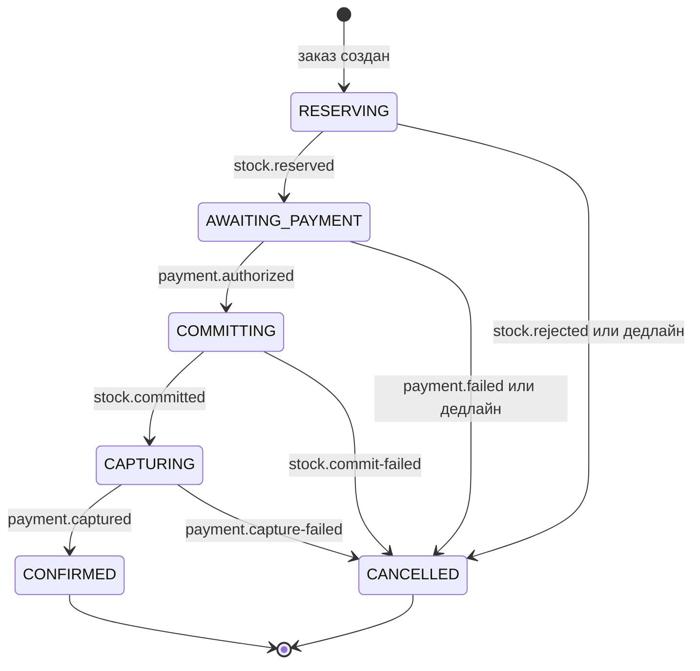
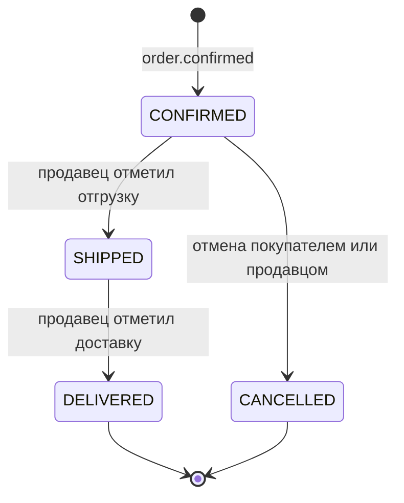

# ADR-0005: Checkout saga — оркестрация в order-сервисе

**Статус:** Принято · **Дата:** 2026-10-23 · **Ревизия:** 5

## Контекст

Заказ покупателя может содержать товары нескольких продавцов. Покупатель платит один раз за весь заказ, а дальше заказ делится на под-заказы — по одному на продавца. Каждый продавец отгружает свой под-заказ со своего склада (FBS, ТЗ, раздел 1).

Оформление меняет данные трёх сервисов: order (заказ), erp (резервы на складах продавцов), payment (деньги покупателя). Общей транзакции между ними нет: у каждого сервиса своя база (ADR-0004).

Требования:

1. **Не брать деньги за товар, которого нет.** Деньги списываются только тогда, когда товар гарантированно закреплён за заказом.
2. **Не держать товар бесконечно**, если покупатель не заплатил.
3. **Не терять деньги покупателя.** Каждое списание заканчивается подтверждённым под-заказом или возвратом.
4. **Переживать падение любого сервиса и повторную доставку любого сообщения.**

Особенность шага оплаты: платит человек на странице провайдера. Это занимает минуты, а может не случиться вовсе. Брошенный checkout — обычный сценарий, а не авария. Сообщения при этом могут приходить в любом порядке: покупатель может заплатить уже после того, как заказ отменён по таймауту.

## Рассмотренные варианты

**Координация шагов:**

| Вариант                                                 | Плюсы                                                                                                                     | Минусы                                                                                                                                                |
| ------------------------------------------------------- | ------------------------------------------------------------------------------------------------------------------------- | ----------------------------------------------------------------------------------------------------------------------------------------------------- |
| Распределённая транзакция (2PC)                         | Атомарность                                                                                                               | Kafka и отдельные базы так не работают; блокировки держались бы минутами, пока покупатель платит                                                      |
| Хореография: каждый сервис реагирует на события соседей | Нет центра, сервисы слабо связаны                                                                                         | Процесс размазан по трём сервисам, состояние заказа не видно в одном месте; непонятно, кто владеет таймаутами; компенсации и гонки разбросаны по коду |
| **Оркестрация в order**                                 | Процесс и состояние в одном месте — явная машина состояний; таймауты принадлежат оркестратору; переходы легко тестировать | order знает команды erp и payment; в одном сервисе больше логики                                                                                      |

**Оплата:**

| Вариант                                   | Плюсы                                                                                   | Минусы                                                                                                                     |
| ----------------------------------------- | --------------------------------------------------------------------------------------- | -------------------------------------------------------------------------------------------------------------------------- |
| Одним шагом: деньги списываются сразу     | Проще у провайдера                                                                      | Если товар не удалось закрепить, деньги уже ушли: нужен возврат, покупатель ждёт его, в журнале появляются лишние проводки |
| **Два шага: авторизация, затем списание** | До списания любая отмена — просто снятие авторизации: деньги не двигаются, проводок нет | Ещё один шаг saga; у авторизации есть срок жизни у провайдера                                                              |

Выбраны оркестрация и оплата в два шага. Для учебного проекта у них есть ещё один плюс: машина состояний, компенсации и гонки видны явно, их можно разобрать и протестировать.

## Решение

### 1. Заказ и под-заказы

- **Заказ** (`orderId`) — весь заказ покупателя: одна оплата, одна saga оформления.
- **Под-заказ** (`subOrderId`) — часть заказа одного продавца. Отгрузка, отмена и деньги продавца считаются по под-заказу.
- Под-заказы формируются при создании заказа: позиции группируются по `sellerId`.
- Продавец видит под-заказ только после подтверждения заказа: незавершённое оформление ещё может отмениться.
- Заказ — корневой агрегат. Все события заказа и его под-заказов публикуются с ключом `orderId` и идут по порядку (ADR-0002, п. 4). У них одна последовательность `aggregateVersion` — версия заказа (`checkout_sagas.version`, п. 7).

### 2. Роли

| Роль        | Кто                                                                                                           | Как взаимодействует                                                            |
| ----------- | ------------------------------------------------------------------------------------------------------------- | ------------------------------------------------------------------------------ |
| Оркестратор | order: `CheckoutSaga` (одна на заказ) и действия с под-заказами                                               | Отправляет команды, слушает ответы, владеет таймаутами и статусами под-заказов |
| Участники   | erp — резервы на складах всех продавцов заказа; payment — авторизация, списание, отмена авторизации, возврат  | Действуют **только по командам оркестратора**, отвечают событиями              |
| Наблюдатели | erp — реестр продаж и списание при отгрузке; payment — удержание денег продавца (ADR-0007); crm; notification | Слушают **только итоговые события**: `order.*` и `sub-order.*`                 |

Наблюдатели не используют промежуточные события saga (`stock.reserved`, `payment.authorized`, `payment.captured`): заказ ещё может быть отменён (п. 4). Исключение — окончательные факты о деньгах: `payment.refunded` и `payout.*`. По ним, например, notification отправляет письма.

### 3. Команды и события

|              | Команда                                              | Событие                                                   |
| ------------ | ---------------------------------------------------- | --------------------------------------------------------- |
| Смысл        | Просьба выполнить действие                           | Факт, который уже произошёл                               |
| Имя (`type`) | PascalCase, повелительное наклонение: `ReserveStock` | `сущность.действие` в прошедшем времени: `stock.reserved` |
| Топик        | Топик получателя: `<context>.commands`               | Топик владельца: `<context>.events`                       |
| Получатели   | Ровно один сервис                                    | Любое число consumer groups                               |
| Replay       | Никогда                                              | Да (ADR-0002, п. 9)                                       |

Команды и ответы на них:

| Команда                                                                                                          | Получатель | Успех                                                                   | Неуспех                                 |
| ---------------------------------------------------------------------------------------------------------------- | ---------- | ----------------------------------------------------------------------- | --------------------------------------- |
| `ReserveStock { orderId, lines: [{ subOrderId, sellerId, skuId, qty }] }`                                          | erp        | `stock.reserved`                                                        | `stock.rejected { unavailable: [skuId] }` |
| `CreatePayment { orderId, amountMinor, currency }`                                                               | payment    | `payment.created { paymentId, paymentUrl }`, затем `payment.authorized` | `payment.failed`                        |
| `CommitStock { orderId }`                                                                                        | erp        | `stock.committed`                                                       | `stock.commit-failed`                   |
| `CapturePayment { orderId, subOrders: [{ subOrderId, sellerId, lines: [{ skuId, categoryPath, amountMinor }] }] }` | payment    | `payment.captured`                                                      | `payment.capture-failed`                |
| `ReleaseStock { orderId, subOrderId? }`                                                                          | erp        | `stock.released`                                                        | —                                       |
| `CancelPayment { orderId }`                                                                                      | payment    | `payment.cancelled`                                                     | —                                       |
| `RefundPayment { orderId, subOrderId }`                                                                          | payment    | `payment.refunded`                                                      | — (ретраи, алерт)                       |

- Конверт тот же, что у событий (ADR-0002, п. 5). `correlationId` — один на всё оформление; `causationId` — `eventId` сообщения, которое вызвало это.
- **Ключ всех команд — `orderId`.** Команды одного заказа лежат в одной партиции и выполняются по порядку: `ReleaseStock` — после `ReserveStock`, `RefundPayment` — после `CapturePayment`. Поэтому проводки списания (ADR-0007) всегда появляются раньше, чем их сторно при возврате.
- `CapturePayment` несёт разбивку по под-заказам и категориям: по ней payment считает комиссию и долг каждому продавцу (ADR-0007).
- `ReleaseStock` без `subOrderId` снимает резервы всего заказа, с `subOrderId` — только этого под-заказа.
- Схемы команд — в `libs/contracts/src/commands/` (ADR-0003).

### 4. Машина состояний оформления



Переходы. Команды и события заказа записываются в outbox в той же транзакции, что и новое состояние:

| Состояние          | Сообщение                | Новое состояние    | Команды                                                                                      | Событие заказа                            |
| ------------------ | ------------------------ | ------------------ | -------------------------------------------------------------------------------------------- | ----------------------------------------- |
| —                  | `POST /orders`           | `RESERVING`        | `ReserveStock`                                                                               | `order.created`                           |
| `RESERVING`        | `stock.reserved`         | `AWAITING_PAYMENT` | `CreatePayment`                                                                              | —                                         |
| `RESERVING`        | `stock.rejected`         | `CANCELLED`        | —                                                                                            | `order.cancelled` (`out_of_stock`)        |
| `RESERVING`        | дедлайн резерва          | `CANCELLED`        | `ReleaseStock` — на случай, если резерв всё же сделан                                        | `order.cancelled` (`reservation_timeout`) |
| `AWAITING_PAYMENT` | `payment.created`        | без изменений      | — (сохраняется `paymentUrl`)                                                                 | —                                         |
| `AWAITING_PAYMENT` | `payment.authorized`     | `COMMITTING`       | `CommitStock`                                                                                | —                                         |
| `AWAITING_PAYMENT` | `payment.failed`         | `CANCELLED`        | `ReleaseStock`                                                                               | `order.cancelled` (`payment_failed`)      |
| `AWAITING_PAYMENT` | дедлайн оплаты           | `CANCELLED`        | `CancelPayment`, `ReleaseStock`                                                              | `order.cancelled` (`payment_timeout`)     |
| `COMMITTING`       | `stock.committed`        | `CAPTURING`        | `CapturePayment`                                                                             | —                                         |
| `COMMITTING`       | `stock.commit-failed`    | `CANCELLED`        | `CancelPayment` — снять авторизацию; `ReleaseStock` — на случай, если часть резерва осталась | `order.cancelled` (`out_of_stock`)        |
| `COMMITTING`       | дедлайн закрепления      | без изменений      | `CommitStock` повторно + алерт                                                               | —                                         |
| `CAPTURING`        | `payment.captured`       | `CONFIRMED`        | —                                                                                            | `order.confirmed`                         |
| `CAPTURING`        | `payment.capture-failed` | `CANCELLED`        | `ReleaseStock`, `CancelPayment`                                                              | `order.cancelled` (`capture_failed`)      |
| `CAPTURING`        | дедлайн списания         | без изменений      | `CapturePayment` повторно + алерт                                                            | —                                         |

Поздние сообщения — пришли, когда оформление уже в финальном состоянии:

| Состояние                | Сообщение                                                    | Действие                                                                                         |
| ------------------------ | ------------------------------------------------------------ | ------------------------------------------------------------------------------------------------ |
| `CANCELLED`              | `payment.authorized`                                         | `CancelPayment`: покупатель заплатил после отмены — авторизация снимается, деньги не списывались |
| `CANCELLED`              | `stock.reserved`                                             | `ReleaseStock` (идемпотентно — на случай, если первая команда ушла в DLQ)                        |
| `CONFIRMED`, `CANCELLED` | ответы на компенсации: `stock.released`, `payment.cancelled` | Записать результат компенсации                                                                   |
| Любое                    | сообщение, неожиданное для состояния                         | Игнорировать, записать в лог с `orderId` и состоянием                                            |

**Точка невозврата — `payment.captured`.** До неё любая отмена снимает резерв и авторизацию, и деньги покупателя не двигаются. После неё весь заказ уже не отменяется: отменить можно только отдельный под-заказ, с возвратом денег (п. 5).

Реализация — чистая функция в `domain` order-сервиса:

```ts
transition(saga: CheckoutSagaState, input: SagaInput): {
  saga: CheckoutSagaState;
  commands: SagaCommand[];
  events: OrderEvent[];
}
```

Дедлайн — такой же вход функции, как событие. Функция не знает про Kafka и базу, поэтому каждая строка таблиц выше превращается в unit-тест (п. 11).

### 5. Жизнь под-заказа после подтверждения



| Действие          | Кто                       | Переход                 | Команды                                                                    | Событие                                                       |
| ----------------- | ------------------------- | ----------------------- | -------------------------------------------------------------------------- | ------------------------------------------------------------- |
| Отгрузить         | продавец (право `orders`) | `CONFIRMED → SHIPPED`   | —                                                                          | `sub-order.shipped`: erp списывает остаток                    |
| Отметить доставку | продавец (право `orders`) | `SHIPPED → DELIVERED`   | —                                                                          | `sub-order.delivered`: payment запускает удержание (ADR-0007) |
| Отменить          | покупатель или продавец   | `CONFIRMED → CANCELLED` | `ReleaseStock { subOrderId }`, `RefundPayment { subOrderId }` | `sub-order.cancelled`                                         |

- **Статусом под-заказа владеет order.** Действия продавца и покупателя идут в API order через gateway. Действия с под-заказами одного заказа сериализуются блокировкой строки заказа (п. 7), поэтому отгрузка и отмена одного под-заказа одновременно пройти не могут, а события разных под-заказов получают разные версии заказа.
- Отмена после отгрузки невозможна: это уже возврат (после MVP, отдельная saga).
- Остальные под-заказы заказа отмена не затрагивает.
- Результаты компенсаций (`stock.released`, `payment.refunded`) order записывает. Если `payment.refunded` не пришёл за 1 час — алерт.

### 6. Таймеры

| Шаг                                 | Дедлайн | По истечении                                    |
| ----------------------------------- | ------- | ----------------------------------------------- |
| Резерв (ответ erp)                  | 30 с    | Отмена (`reservation_timeout`)                  |
| Авторизация (оплата покупателем)    | 15 мин  | Отмена (`payment_timeout`)                      |
| Закрепление резерва (`CommitStock`) | 5 мин   | Повтор команды + алерт; заказ **не** отменяется |
| Списание денег (`CapturePayment`)   | 5 мин   | Повтор команды + алерт                          |
| Возврат при отмене под-заказа       | 1 ч     | Алерт                                           |

- Значения задаются через env; в e2e-тестах — секунды.
- Срок жизни авторизации у провайдера (в `fake-psp` — настройка, по умолчанию 7 дней) намного больше всех дедлайнов.
- Дедлайн хранится в `checkout_sagas.deadline_at`. Планировщик в order раз в 5 с выбирает просроченные saga и для каждой применяет `transition` в той же транзакции, что и запись в outbox:

  ```sql
  SELECT * FROM checkout_sagas
  WHERE deadline_at < now()
    AND state IN ('RESERVING', 'AWAITING_PAYMENT', 'COMMITTING', 'CAPTURING')
  ORDER BY deadline_at
  LIMIT 100
  FOR UPDATE SKIP LOCKED;
  ```

  `SKIP LOCKED` позволяет запускать несколько инстансов order.

- **Страховка в erp:** незакреплённый резерв живёт 30 мин (больше дедлайна оплаты с запасом) и снимается самим erp, даже если order не прислал `ReleaseStock` — например, потому что упал надолго. Закреплённый резерв по TTL не истекает.

### 7. Хранение и конкурентность

```sql
CREATE TABLE checkout_sagas (
  order_id      text        PRIMARY KEY,
  state         text        NOT NULL,
  payment_id    text,
  payment_url   text,
  cancel_reason text,
  deadline_at   timestamptz,
  version       int         NOT NULL DEFAULT 0,   -- aggregateVersion заказа: +1 на каждое событие заказа или под-заказа
  correlation_id text       NOT NULL,             -- цепочка POST /orders: в ней работает планировщик дедлайнов
  trace_headers jsonb       NOT NULL DEFAULT '{}', -- traceparent POST /orders: дедлайн продолжает трейс оформления
  updated_at    timestamptz NOT NULL DEFAULT now()
);

CREATE INDEX checkout_sagas_due ON checkout_sagas (deadline_at)
  WHERE state IN ('RESERVING', 'AWAITING_PAYMENT', 'COMMITTING', 'CAPTURING');

CREATE TABLE sub_orders (
  sub_order_id text        PRIMARY KEY,
  order_id     text        NOT NULL,
  seller_id    text        NOT NULL,
  status       text        NOT NULL,   -- PENDING до подтверждения заказа, затем CONFIRMED, SHIPPED, DELIVERED, CANCELLED
  amount_minor bigint      NOT NULL,
  updated_at   timestamptz NOT NULL DEFAULT now()
);

CREATE INDEX sub_orders_seller ON sub_orders (seller_id, status);
```

- Статус оформления в API берётся из `checkout_sagas.state`, статусы под-заказов — из `sub_orders.status`. Отдельного общего статуса в `orders` нет — иначе появятся два источника правды.
- Сообщения одной saga приходят из разных топиков (`erp.events`, `payment.events`) и от планировщика, и их могут обрабатывать параллельно. Поэтому каждый обработчик в одной транзакции:
  1. блокирует строку saga: `SELECT … FROM checkout_sagas WHERE order_id = $1 FOR UPDATE`;
  2. проверяет `processed_events` (ADR-0002, п. 7);
  3. вызывает `transition`;
  4. записывает новое состояние, статусы под-заказов и outbox.

  Блокировка строки сериализует переходы. Например, из одновременных `payment.authorized` и дедлайна оплаты победит что-то одно, а второе увидит уже новое состояние и обработается по таблице поздних сообщений.

- Действия с под-заказом блокируют **сначала строку заказа, потом строку под-заказа**:

  ```sql
  SELECT … FROM checkout_sagas WHERE order_id = $1 FOR UPDATE;
  SELECT … FROM sub_orders WHERE sub_order_id = $2 FOR UPDATE;
  ```

  Блокировки только строки под-заказа мало. События всех под-заказов несут общую `aggregateVersion` заказа. Если продавец A отгружает свой под-заказ, а покупатель одновременно отменяет под-заказ B, обе транзакции получат одну и ту же следующую версию. Read-model с проверкой версии (ADR-0004, п. 3, правило 5) молча отбросит одно из событий.

- `version` увеличивается только под блокировкой строки заказа, в той же транзакции, что и запись событий в outbox. Порядок блокировок всегда одинаковый, «заказ → под-заказ», поэтому deadlock исключён.

### 8. Правила для участников

**erp**

- `ReserveStock` идемпотентна по `orderId`: повторная команда публикует тот же результат ещё раз.
- Резерв «всё или ничего» по всему заказу, включая разных продавцов: склады всех продавцов лежат в одной базе erp, поэтому это одна локальная транзакция. Если чего-то не хватает — `stock.rejected` со списком недостающих SKU, и покупатель правит корзину.
- Каждая позиция резервируется на одном складе своего продавца: на первом по приоритету, где хватает остатка.
- Строки остатков блокируются в порядке сортировки `(warehouse_id, sku_id)`, чтобы два заказа с одинаковыми товарами не попали в deadlock:

  ```sql
  UPDATE stock SET reserved = reserved + $3
  WHERE warehouse_id = $1 AND sku_id = $2 AND on_hand - reserved >= $3;   -- 0 строк: товара не хватает
  ```

- **`CommitStock` закрепляет резерв:** снимает TTL, `on_hand` не меняется. Товар физически остаётся на складе до отгрузки.
- **Списание — по `sub-order.shipped`:** `on_hand` и `reserved` уменьшаются на количество из под-заказа.
- `ReleaseStock` снимает и незакреплённый, и закреплённый резерв, но не отгруженный.
- Незакреплённый резерв по истечении TTL снимается самим erp с публикацией `stock.released`. `CommitStock` для такого резерва: erp пытается зарезервировать заново; если товара нет — `stock.commit-failed`.
- Команды для неизвестного или уже завершённого резерва ничего не меняют и отвечают текущим статусом.

**payment**

- Внешний провайдер локально — контейнер-заглушка `fake-psp`: страница оплаты с кнопками «Оплатить» и «Отклонить», API авторизации, списания, отмены, возврата и выплат, webhook в payment через gateway.
- `CreatePayment` идемпотентна по `orderId`: на заказ один активный платёж.
- Webhook проверяется по подписи (HMAC). Провайдер может прислать его повторно, поэтому обработка идемпотентна по id события провайдера.
- `payment.failed` — только окончательный отказ (платёж у провайдера истёк или отменён). Отклонённая попытка оплаты картой его не порождает: покупатель может попробовать ещё раз.
- `CancelPayment`: неоплаченный платёж отменяется, авторизация снимается. Для уже списанного платежа команда невозможна по машине состояний; если она всё же пришла — ошибка в лог и алерт.
- `CapturePayment` идемпотентна по `orderId` и в той же транзакции создаёт проводки списания (ADR-0007).
- `RefundPayment` идемпотентна по `(orderId, subOrderId)`. Сумму возврата payment берёт из своего расчёта (`settlements.gross_minor`, ADR-0007), а не из команды: у суммы один источник. В MVP возврат всегда полный по под-заказу. Частичные возвраты (после MVP) добавят в команду сумму и проверку `сумма ≤ gross − уже возвращено`.

### 9. HTTP

**Оформление**

- `POST /orders` с заголовком `Idempotency-Key` (UUID; storefront генерирует его один раз на попытку оформления):
  - ответ `202 Accepted`, `{ orderId, status: "RESERVING" }`;
  - повтор с тем же ключом и тем же телом — тот же `orderId` и текущий статус;
  - тот же ключ с другим телом — `422`;
  - ключ сохраняется в той же транзакции, что и заказ. Конкурентный повтор ждёт коммита первой транзакции на вставке в `idempotency_keys`, получает `unique_violation`, откатывается и в новой транзакции читает сохранённый `order_id`.

  ```sql
  CREATE TABLE idempotency_keys (
    user_id      text        NOT NULL,
    key          uuid        NOT NULL,
    request_hash text        NOT NULL,
    order_id     text        NOT NULL,
    created_at   timestamptz NOT NULL DEFAULT now(),
    PRIMARY KEY (user_id, key)
  );
  -- ключи старше 24 ч удаляются фоновой задачей
  ```

- `GET /orders/:id` возвращает статус оформления, под-заказы, а в `AWAITING_PAYMENT` — ещё и `paymentUrl`. Storefront опрашивает его раз в секунду и перенаправляет покупателя на страницу оплаты.
- Цены берутся из read-model каталога в order и фиксируются в строках заказа (ADR-0001, п. 2).

**Под-заказы**

| Запрос                         | Кто                     | Переход                 |
| ------------------------------ | ----------------------- | ----------------------- |
| `POST /seller/sub-orders/:id/ship`             | продавец   | `CONFIRMED → SHIPPED`   |
| `POST /seller/sub-orders/:id/deliver`          | продавец   | `SHIPPED → DELIVERED`   |
| `POST /seller/sub-orders/:id/cancel`           | продавец   | `CONFIRMED → CANCELLED` |
| `POST /orders/:orderId/sub-orders/:id/cancel`  | покупатель | `CONFIRMED → CANCELLED` |

Пути покупателя и продавца раздельные (SD-03, решение 4): у владельца магазина есть и роль `buyer`, и по одному токену не понять, в какой роли он отменяет.

- Повтор действия, которое уже выполнено, возвращает `200` и текущий статус. Недопустимый переход — `409`.
- Чужой под-заказ — `404` (ADR-0006).

В реализации id — `uuid`, а не `text` (SD-01, п. 6.1). Webhook провайдера в payment так же продолжает цепочку и трейс оформления: их хранит строка платежа (SD-02, п. 6.1, 7).

### 10. Этапы

| Этап (ТЗ, раздел 8) | Что работает                                                                                                                                             |
| ------------------- | -------------------------------------------------------------------------------------------------------------------------------------------------------- |
| 2 — без склада      | `AWAITING_PAYMENT → CAPTURING → CONFIRMED`: шаги `RESERVING` и `COMMITTING` пропускаются. Отмена по дедлайну и снятие поздней авторизации есть уже здесь. Таблица переходов этапа — SD-02, п. 5.2 ✅ |
| 3 — склад           | Полная машина; отгрузка списывает остаток; отмена под-заказа снимает резерв                                                                              |
| 4 — деньги          | Проводки при списании и возврате; удержание по `sub-order.delivered` (ADR-0007)                                                                          |

### 11. Тестирование

- **Unit:** табличные тесты `transition` и переходов под-заказа — по тесту на каждую строку таблиц п. 4 и п. 5.
- **Интеграционные** (настоящий Postgres): одновременные `payment.authorized` и дедлайн оплаты дают ровно один переход; одновременные отгрузка и отмена под-заказа — ровно одно действие; одновременные действия с **разными** под-заказами одного заказа дают события с версиями N+1 и N+2, без дубля.
- **E2E** (compose + `fake-psp`, дедлайны в секундах):

| №   | Сценарий                                         | Ожидаемый результат                                             |
| --- | ------------------------------------------------ | --------------------------------------------------------------- |
| 1   | Заказ у двух продавцов, оплата прошла            | `CONFIRMED`, два под-заказа, резервы закреплены, деньги списаны |
| 2   | У одного из продавцов нет товара                 | `CANCELLED` (`out_of_stock`), оплата не запрашивалась           |
| 3   | Покупатель не заплатил                           | `CANCELLED` по дедлайну, резерв снят                            |
| 4   | Покупатель заплатил после дедлайна               | `CANCELLED`, авторизация снята, проводок нет                    |
| 5   | Закрепление резерва не удалось после авторизации | `CANCELLED`, авторизация снята, деньги не списывались           |
| 6   | Каждое сообщение saga доставлено дважды          | Результат как в сценарии 1                                      |
| 7   | order убит между шагами                          | После рестарта saga продолжается с того же состояния            |
| 8   | erp недоступна во время `CommitStock`            | После восстановления — `CONFIRMED`                              |
| 9   | Два `POST /orders` с одним `Idempotency-Key`     | Один заказ                                                      |
| 10  | Продавец отменяет свой под-заказ                 | Резерв снят, частичный возврат, второй под-заказ не затронут    |
| 11  | Отгрузка и отмена одного под-заказа одновременно | Проходит ровно одно действие                                    |

## Последствия

**Плюсы**

- Весь процесс оформления — в одном месте и в одной функции переходов.
- До списания деньги покупателя не двигаются: отмена на любом шаге не требует возврата.
- Гарантия по деньгам: каждое списание заканчивается подтверждённым под-заказом или возвратом.
- Таймауты и гонки описаны явно и покрыты тестами.

**Минусы и цена**

- order зависит от контрактов команд erp и payment.
- Много сообщений: до 7 команд и около 12 событий на одно оформление.
- Товар заморожен до 15 минут, пока покупатель думает над оплатой.
- Заказ отменяется целиком, если не хватает товара хотя бы у одного продавца; покупатель правит корзину и оформляет заново.

**Правила для code review**

- наблюдатель реагирует на промежуточные события saga;
- участник меняет резерв или платёж без команды оркестратора;
- списание денег до закрепления резерва;
- переход без блокировки строки `checkout_sagas`; действие с под-заказом без блокировки сначала заказа, потом под-заказа;
- `RefundPayment` с суммой из команды вместо расчёта в payment;
- отмена под-заказа без `RefundPayment` или после отгрузки;
- команда с ключом, отличным от `orderId`;
- переход, для которого нет строки в таблицах п. 4–5 и теста.

## Открытые вопросы

- Частичный резерв, когда товара не хватает у одного продавца, — сейчас заказ отменяется целиком.
- Возвраты после доставки и споры — отдельная saga.
- Push статуса на фронт (SSE) вместо опроса `GET /orders/:id`.

## Связанные решения

- ТЗ: требования и этапы.
- ADR-0001: владение данными, синхронные вызовы.
- ADR-0002: Kafka, топики команд, outbox, `processed_events`, DLQ.
- ADR-0003: контракты команд в `libs/contracts`.
- ADR-0004: отдельные базы, read-models.
- ADR-0006: изоляция продавцов, права на действия с под-заказами.
- ADR-0007: проводки при списании, возврате и удержании.
- SD-00: обзор архитектуры и каталог сообщений.

## Когда пересмотреть решение

- Появляется вторая saga (например, возврат) → выделить общий механизм (таблица saga, планировщик дедлайнов, транзакционная обработка) в `libs/`.
- Логика оркестрации выходит за рамки заказа → рассмотреть отдельный сервис или движок процессов (например, Temporal).
