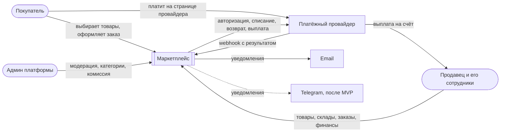
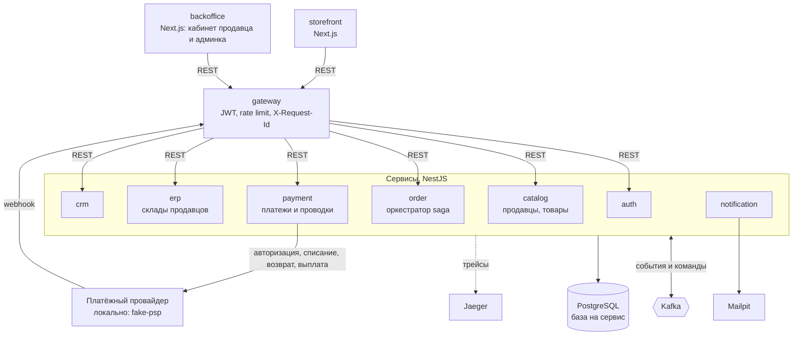
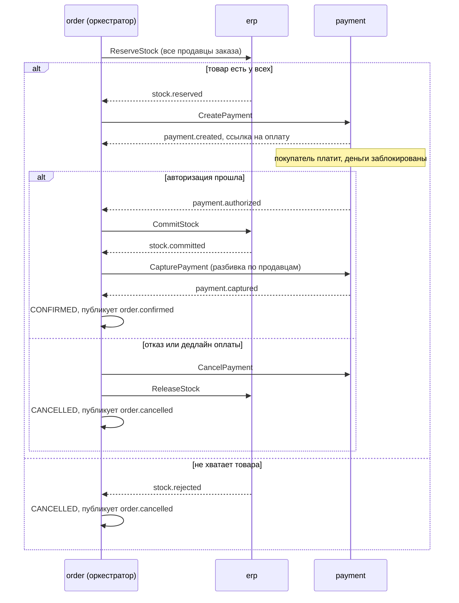
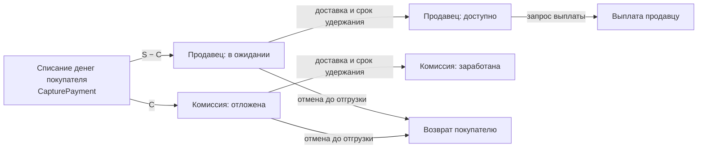
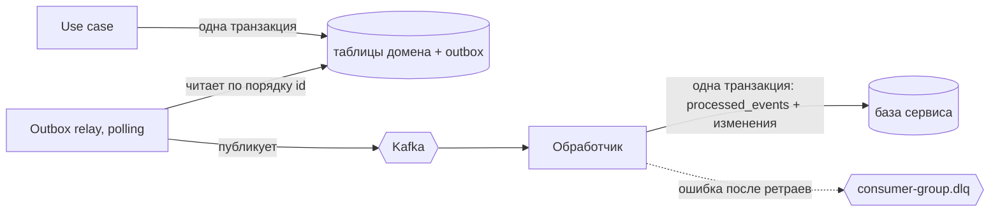

# System Design 00: Общая архитектура

**Статус:** Актуально · **Дата:** 2026-10-23 · **Ревизия:** 8

Документ — карта системы: схемы и связи. Требования — в ТЗ, правила и детали — в ADR. Если документ и ADR расходятся, прав ADR, а документ исправляется.

| Документ | О чём                                                                  |
| -------- | ---------------------------------------------------------------------- |
| ТЗ       | Требования, MVP, этапы                                                 |
| ADR-0001 | Микросервисы поэтапно, владение данными, взаимодействие, наблюдаемость |
| ADR-0002 | Kafka: топики, ключи, конверт, outbox, идемпотентность, DLQ, replay    |
| ADR-0003 | Nx monorepo, контракты, границы модулей                                |
| ADR-0004 | Database per service, read-models, Prisma, миграции                    |
| ADR-0005 | Checkout saga, жизнь под-заказа                                        |
| ADR-0006 | Изоляция продавцов, роли и права                                       |
| ADR-0007 | Деньги: журнал проводок, комиссия, удержание, выплаты                  |

## 1. Контекст (C4 L1)

Система — один блок, вокруг неё люди и внешние системы. Это multi-vendor маркетплейс: продавцы хранят товар на своих складах и сами его отгружают (FBS).



## 2. Контейнеры (C4 L2)



- Наружу открыт только gateway: фронты и webhook провайдера ходят через него (ADR-0001, п. 1).
- Порты хоста в compose: gateway — 3000; `fake-psp` — 4000: он изображает внешний провайдер, и браузер покупателя открывает его страницу оплаты напрямую. Остальные — инструменты: Jaeger 16686, Kafbat UI, Mailpit, Postgres и Kafka для локальной отладки. Внутренние сервисы своих портов наружу не публикуют (SD-02, п. 3).
- gateway: маршруты в сервисы, проверка JWT по JWKS auth, лимит запросов на пользователя, `X-Request-Id`; тело запроса передаётся потоком без разбора (SD-02, п. 3.1). Вход и токены `/api/auth/**` — в auth, витрина `/api/catalog/**` — в catalog, обе публичны; регистрация магазина `/api/sellers` — в catalog (SD-05, п. 3). Кабинет продавца — `/api/seller/**`: магазин и товары — в catalog, сотрудники — в auth, под-заказы — в order, склады, остатки и реестр продаж — в erp (SD-03, п. 3), финансы и выплаты — в payment; админка: модерация магазинов и товаров, категории — в catalog, деньги — в payment (SD-04, п. 4, 8; SD-05, п. 6).
- Каждый сервис сам проверяет JWT через `libs/auth` и не доверяет заголовкам с идентичностью (ADR-0006, п. 4).
- Один инстанс Postgres; у каждого сервиса своя база и пользователь: `auth_db`, `catalog_db`, `order_db`, `payment_db`, `erp_db`, `crm_db`, `notification_db`. У gateway базы нет (ADR-0004).
- Кто что публикует и читает — раздел 3. Стрелка к Kafka на схеме показывает только, что все сервисы работают через неё.
- Redis нет: корзина хранится в `order_db`. Redis понадобится, только если gateway станет несколько инстансов и rate limit нужно будет делить между ними.
- Kafbat UI — инструмент отладки (ADR-0002, п. 10), на схеме не показан.

## 3. Каталог сообщений

Источник истины — схемы в `libs/contracts` (ADR-0003). Таблицы ниже — обзор; они обновляются в одном коммите с контрактами.

- Команда идёт в топик получателя, событие — в топик владельца (ADR-0005, п. 3).
- Наблюдатели слушают итоговые события заказа и под-заказа, а не промежуточные шаги saga (ADR-0005, п. 2).

**Команды** — только у оркестратора (order):

| Команда                                                             | Топик              | Ключ      | Выполняет |
| ------------------------------------------------------------------- | ------------------ | --------- | --------- |
| `ReserveStock`, `CommitStock`, `ReleaseStock`                       | `erp.commands`     | `orderId` | erp       |
| `CreatePayment`, `CancelPayment`, `CapturePayment`, `RefundPayment` | `payment.commands` | `orderId` | payment   |

**События:**

| Событие                                                                                                                      | Топик            | Ключ        | Публикует | Читают                                                                                    |
| ---------------------------------------------------------------------------------------------------------------------------- | ---------------- | ----------- | --------- | ----------------------------------------------------------------------------------------- |
| `user.*` (например, `user.registered`)                                                                                       | `auth.events`    | `userId`    | auth      | crm — профиль клиента; notification — контакты                                            |
| `seller.registered`, `seller.approved`, `seller.rejected`, `seller.blocked`                                                  | `catalog.events` | `sellerId`  | catalog   | auth — членство и права; notification                                                     |
| `product.*`                                                                                                                  | `catalog.events` | `productId` | catalog   | order — read-model товаров и цен                                                          |
| `order.created`                                                                                                              | `order.events`   | `orderId`   | order     | crm — таймлайн                                                                            |
| `category.*`                                                                                                                 | `catalog.events` | `categoryId` | catalog  | payment — проверка ставок комиссии (ADR-0007, п. 4)                                       |
| `order.confirmed`                                                                                                            | `order.events`   | `orderId`   | order     | erp — реестр продаж; crm — LTV, сегменты, таймлайн; notification — покупателю и продавцам |
| `order.cancelled`                                                                                                            | `order.events`   | `orderId`   | order     | crm — таймлайн; notification                                                              |
| `sub-order.shipped`                                                                                                          | `order.events`   | `orderId`   | order     | erp — списание остатка; notification                                                      |
| `sub-order.delivered`                                                                                                        | `order.events`   | `orderId`   | order     | payment — удержание; crm — таймлайн; notification                                         |
| `sub-order.cancelled`                                                                                                        | `order.events`   | `orderId`   | order     | erp — сторно продажи; crm — пересчёт LTV; notification                                    |
| `stock.reserved`, `stock.rejected`, `stock.committed`, `stock.commit-failed`, `stock.released`                               | `erp.events`     | `orderId`   | erp       | order — ответы saga                                                                       |
| `stock.level-changed`                                                                                                        | `erp.events`     | `skuId`     | erp       | catalog — наличие на витрине                                                              |
| `stock.low`                                                                                                                  | `erp.events`     | `skuId`     | erp       | notification — продавцу                                                                   |
| `payment.created`, `payment.authorized`, `payment.failed`, `payment.cancelled`, `payment.captured`, `payment.capture-failed` | `payment.events` | `paymentId` | payment   | order — ответы saga                                                                       |
| `payment.refunded`                                                                                                           | `payment.events` | `paymentId` | payment   | order — результат компенсации; notification — письмо о возврате                           |
| `payout.paid`, `payout.failed`                                                                                               | `payment.events` | `payoutId`  | payment   | notification — продавцу                                                                   |

Топики: `auth.events`, `catalog.events`, `order.events`, `payment.events`, `erp.events`, `erp.commands`, `payment.commands`. DLQ — по одному на consumer group: `<consumer-group>.dlq`. Партиции и сроки хранения — ADR-0002, п. 3.

У crm и notification нет своих топиков событий: пока их события никому не нужны.

## 4. Checkout saga

Оркестратор — order. Один заказ — одна оплата и N под-заказов, по одному на продавца. Оплата в два шага: сначала деньги покупателя блокируются (авторизация), а списываются только после того, как товар закреплён за заказом. Подробно — ADR-0005.



- **Точка невозврата — `payment.captured`.** До неё любая отмена снимает резерв и авторизацию, деньги не двигаются. После неё отменить можно только отдельный под-заказ, с возвратом денег.
- **Поздние сообщения:** `payment.authorized` после отмены → `CancelPayment`; `stock.reserved` после отмены → `ReleaseStock`.
- **Дедлайны:** ответ erp — 30 с, оплата — 15 мин. Незакреплённый резерв в erp снимается сам через 30 мин, даже если order упал.
- **Под-заказ после подтверждения:** `CONFIRMED → SHIPPED → DELIVERED`; отгрузку и доставку отмечает продавец. Отмена до отгрузки — покупателем или продавцом: `ReleaseStock` и `RefundPayment` только для этого под-заказа.
- **Этапы** (ТЗ, раздел 8): на этапе 2 saga работает без склада, на этапе 3 — полностью.

## 5. Деньги

Все деньги — в payment, в журнале проводок по двойной записи (ADR-0007). `S` — сумма под-заказа, `C` — комиссия площадки по ставке категории.



- Суммы — целые тийины, `bigint`.
- Проводки неизменяемы; сумма записей каждой проводки равна нулю — это проверяет база.
- Повтор операции не удваивает деньги: одна проводка на операцию. Двойная выплата невозможна: запрос блокирует строку баланса.

## 6. Изоляция продавцов

Подробно — ADR-0006.

- Все продавцы в общих таблицах; у каждой таблицы с данными продавца есть `seller_id NOT NULL`.
- Каждый метод репозитория принимает область доступа (`buyer`, `seller`, `platform`), которая строится только из проверенного токена.
- Чужой ресурс — `404`; ресурс без нужного права сотрудника — `403`.
- Для каждого эндпоинта кабинета есть автотест изоляции с двумя продавцами.
- На этапе hardening добавляется Row-Level Security в Postgres как вторая линия защиты.

## 7. Надёжная доставка сообщений



| Механизм                               | Что гарантирует                                                                                            | Подробно                                 |
| -------------------------------------- | ---------------------------------------------------------------------------------------------------------- | ---------------------------------------- |
| Outbox                                 | Изменение и сообщение о нём сохраняются атомарно: падение между коммитом и публикацией не теряет сообщение | ADR-0002, п. 6                           |
| `processed_events (handler, event_id)` | Повторная доставка не обрабатывается дважды                                                                | ADR-0002, п. 7                           |
| Ключ партиции                          | Сообщения одной сущности обрабатываются по порядку                                                         | ADR-0002, п. 4                           |
| DLQ на consumer group                  | Сломанное сообщение не блокирует партицию и обрабатывается повторно только своей группой                   | ADR-0002, п. 8                           |
| `Idempotency-Key`                      | Повтор `POST /orders` не создаёт второй заказ                                                              | ADR-0005, п. 9                           |
| Конверт сообщения                      | Единый формат событий и команд                                                                             | ADR-0002, п. 5; схема — `libs/contracts` |

## 8. Слои внутри сервиса

**Полная схема (hexagonal)** — для сервисов с настоящей бизнес-логикой: order (saga, под-заказы), payment (платежи и проводки), erp (резервы), catalog (модерация), crm (профили и сегменты).

```
src/
  domain/          # сущности, value objects, чистые функции (в order — переходы saga); без фреймворков
  application/     # use cases и порты: репозитории, UnitOfWork, публикация сообщений
  infrastructure/  # Prisma-репозитории, outbox и relay, адаптер Kafka, клиент провайдера
  interface/       # HTTP-контроллеры, обработчики сообщений, DTO
```

**Тонкая схема** — для проекций и notification: логики почти нет, и четыре слоя были бы церемонией.

```
src/
  handlers/        # обработчики событий: идемпотентность, upsert в read-model
  repositories/    # Prisma
  api/             # контроллеры, если есть
```

Правила полной схемы:

- `domain` не импортирует NestJS, Prisma, kafkajs, `infrastructure` и `interface`.
- Типы, сгенерированные Prisma, не выходят за `infrastructure`: репозиторий переводит их в доменные сущности.
- Транзакция — порт `UnitOfWork` в `application`. Агрегат, outbox и `processed_events` сохраняются в одной единице работы (ADR-0002).
- Каждый метод репозитория принимает область доступа первым аргументом (ADR-0006, п. 5).
- Доменные события собирает агрегат; в записи outbox их превращает инфраструктура.

Первое правило проверяет линтер:

```js
// eslint.config.mjs
{
  files: ['apps/*/src/domain/**/*.ts'],
  rules: {
    'no-restricted-imports': ['error', {
      patterns: ['@nestjs/*', '@prisma/*', 'kafkajs', '**/generated/**', '**/infrastructure/**', '**/interface/**'],
    }],
  },
}
```

## 9. Тестирование

| Уровень        | Что проверяет                                                                                                                         | Инструменты                                       |
| -------------- | ------------------------------------------------------------------------------------------------------------------------------------- | ------------------------------------------------- |
| Unit           | Домен; use cases с фейками портов; переходы saga — по тесту на строку таблицы (ADR-0005, п. 11); комиссия и проводки (ADR-0007, п. 9) | Jest                                              |
| Property-based | Инварианты журнала проводок на случайных последовательностях операций (ADR-0007, п. 9)                                                | Jest + fast-check                                 |
| Интеграционные | Репозитории; outbox и relay; идемпотентные обработчики; блокировки и гонки; триггеры журнала                                          | Jest + Testcontainers: настоящие Postgres и Kafka |
| Контрактные    | Схемы и upcasters событий и команд по фикстурам (ADR-0003, п. 5)                                                                      | Jest                                              |
| E2E            | Сквозные сценарии через gateway, включая сбои (ADR-0005, п. 11) и изоляцию продавцов (ADR-0006, п. 8)                                 | docker compose + `fake-psp`, дедлайны в секундах  |

- Процент покрытия — не цель. Цель — чтобы у каждого сценария отказа из ADR и каждого критерия этапа из ТЗ был тест.
- Unit-тесты с моками не ловят самые опасные баги этой системы: транзакции с outbox, дубли, порядок сообщений, гонки saga, утечки между продавцами. Для них нужны интеграционные и e2e-тесты.

## 10. Наблюдаемость

- Одна операция пользователя — один трейс: W3C `traceparent` передаётся в HTTP-заголовках и в заголовках Kafka-сообщений, трейсы собирает Jaeger (ADR-0001, п. 6).
- В конверте `correlationId` — один на всё оформление заказа, `causationId` — сообщение, которое вызвало текущее. По ним цепочка saga восстанавливается даже без трейсинга.

## Открытые вопросы

- Срок удержания денег продавца и минимальная сумма выплаты (ТЗ, раздел 10).
- Где живут кросс-доменные отчёты админки (ADR-0004).
- Возвраты после доставки и отрицательный баланс продавца (ADR-0005, ADR-0007).
- Push статуса заказа на фронт (SSE) вместо опроса (ADR-0005).
- gRPC для внутренних синхронных вызовов (ADR-0001).
