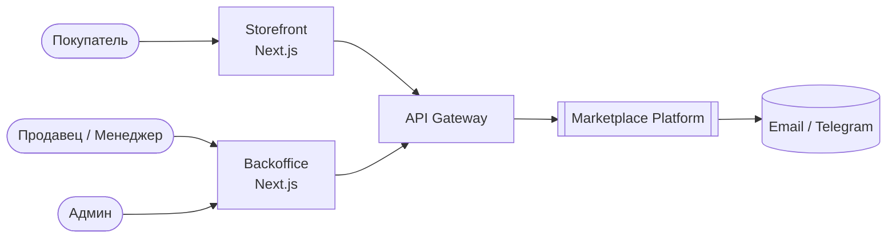
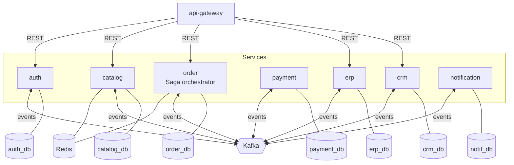
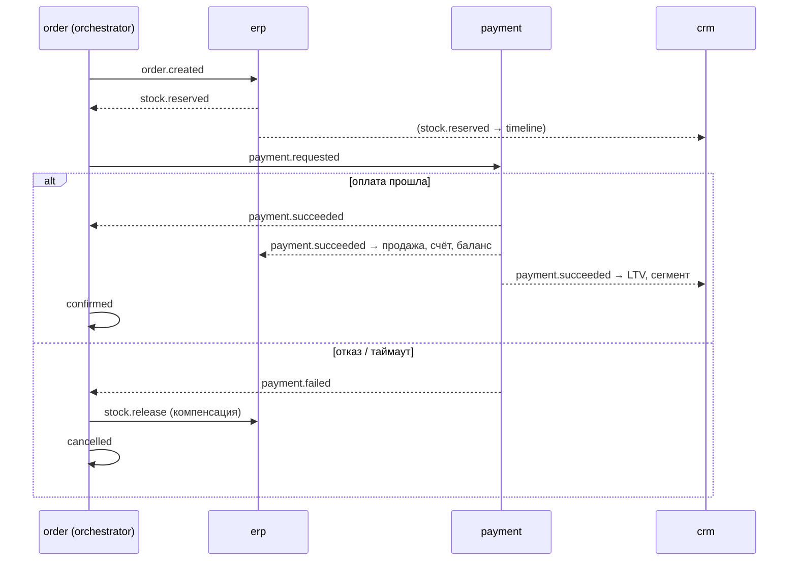
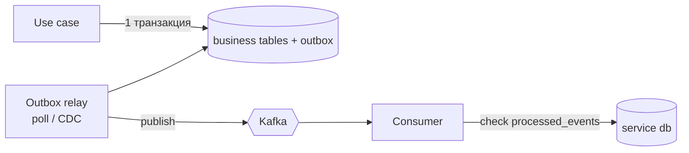

# System Design 00: Общая архитектура

**Статус:** 🟡 Черновик

## 1. Контекст (C4 L1)


## 2. Контейнеры (C4 L2)


## 3. Checkout Saga (happy path + компенсации)


## 4. Надёжная публикация событий

- **Outbox:** нет «двойной записи». Если упадём между commit в БД и publish в Kafka, событие не потеряется.
- **Idempotency:** `processed_events(event_id PK)`, повторная доставка игнорируется.
- **Ключ партиции:** `aggregateId` (orderId, sku), чтобы события одного агрегата шли по порядку.

## 5. Конверт события (libs/contracts)
```ts
interface EventEnvelope<T> {
  eventId: string;        // uuid v7
  type: string;           // 'order.created'
  version: number;        // schema version
  occurredAt: string;     // ISO
  aggregateId: string;
  correlationId: string;
  payload: T;
}
```

## 6. Слои внутри сервиса (Clean / Hexagonal)
```
src/
  domain/          # entities, value objects, domain services: чистый TS, 100% unit-тесты
  application/     # use cases, ports (interfaces)
  infrastructure/  # prisma repos, kafka adapters, outbox relay
  interface/       # controllers, consumers, DTO
```
Jest unit-тесты пишем на `domain` и `application`, порты подменяем моками.

## 7. Топики Kafka (первая версия)
`auth.events`, `catalog.events`, `order.events`, `payment.events`, `erp.events`, `crm.events`, у каждого DLQ `*.dlq`.
Один топик на bounded context, тип события лежит в `type`.
