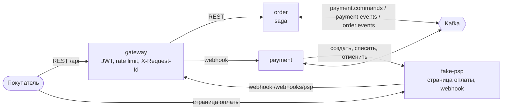
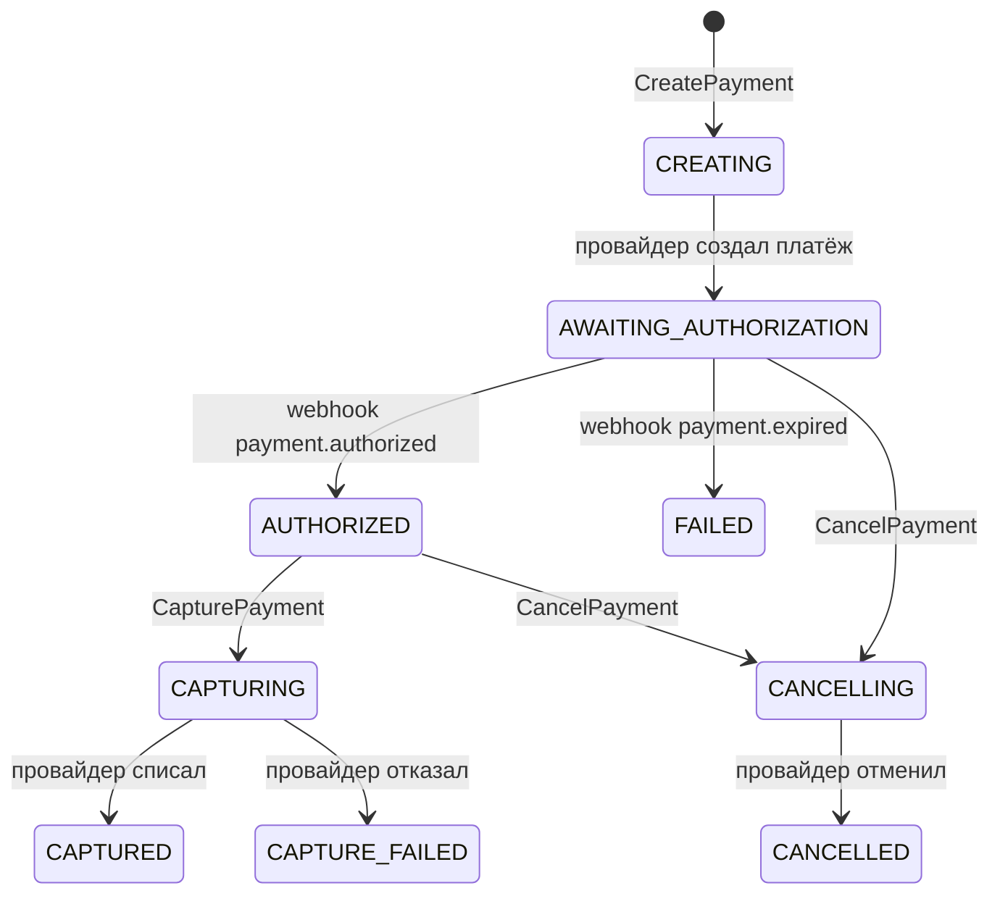

# System Design 02: Оформление без склада (этап 2)

**Статус:** ✅ Утверждено · **Дата:** 2026-10-22 · **Ревизия:** 1

Этап 2 из ТЗ (раздел 8): gateway, order, payment, `fake-psp`. Первый сквозной сценарий — покупатель оформляет заказ у двух продавцов и платит. Склада ещё нет: шаги резерва saga пропускаются (ADR-0005, п. 10). Правила взяты из ADR-0001, 0002, 0005, 0006; здесь — что именно строим и как проверяем.

## 1. Критерий готовности

Из ТЗ, раздел 8, и ADR-0005, п. 11 — те сценарии, которым не нужен склад. Каждый — e2e-тест через gateway на compose (п. 9).

| #   | Сценарий                                                         | Ожидаемый результат                                                                                     |
| --- | ---------------------------------------------------------------- | ------------------------------------------------------------------------------------------------------- |
| 1   | Заказ у двух продавцов, оплата прошла                            | `CONFIRMED`, два под-заказа; у провайдера одна авторизация и одно списание на полную сумму                |
| 2   | Весь сценарий 1 в Jaeger                                         | Один трейс со спанами gateway, order, payment и запросами к провайдеру (п. 7)                           |
| 3   | payment остановлен, покупатель платит, payment запущен снова     | `CONFIRMED`; списание у провайдера одно                                                                  |
| 4   | payment падает между списанием у провайдера и записью результата | После перезапуска — `CONFIRMED`; повторное списание у провайдера не происходит (интеграционный тест, п. 9) |
| 5   | Покупатель не заплатил                                           | `CANCELLED` (`payment_timeout`) по дедлайну, платёж у провайдера отменён                                  |
| 6   | Покупатель заплатил после дедлайна                               | `CANCELLED`, авторизация снята, списания нет                                                             |
| 7   | Карта отклонена, вторая попытка успешна                          | `CONFIRMED`: отклонённая попытка не отменяет заказ (ADR-0005, п. 8)                                      |
| 8   | Платёж истёк у провайдера                                        | `CANCELLED` (`payment_failed`)                                                                           |
| 9   | Провайдер шлёт каждый webhook дважды                             | Как в сценарии 1                                                                                         |
| 10  | order убит в `AWAITING_PAYMENT`, покупатель платит, order запущен | `CONFIRMED`: saga продолжается с того же состояния                                                       |
| 11  | Два `POST /orders` с одним `Idempotency-Key`                     | Один заказ; тот же ключ с другим телом — `422`                                                           |
| 12  | Покупатель B запрашивает заказ покупателя A; запрос без токена   | `404`; `401`                                                                                             |

Плюс: CI зелёный, новый job `e2e` (п. 10).

## 2. Что входит и что нет

**Входит:**
- `apps/gateway`, `apps/order`, `apps/payment`, `apps/fake-psp`.
- `libs/auth`: проверка JWT по JWKS, область доступа (ADR-0006). На этом этапе токены выпускает заглушка в gateway (п. 3.1).
- Контракты команд и событий оформления в `libs/contracts`.
- Seed-каталог двух продавцов в read-model order (ТЗ, раздел 8).
- Генератор сервиса: режим `--bare` без базы и Kafka (для gateway и fake-psp) и порт хоста только по `--port` (п. 8).
- Проект `apps/e2e` и CI job `e2e`.

**Не входит:**
- Склад: `RESERVING`, `COMMITTING`, команды erp — этап 3.
- Действия с под-заказом (отгрузка, доставка, отмена) — этап 3: отмене нужен `ReleaseStock`, отгрузке — списание остатка.
- Проводки, комиссия, возвраты (`RefundPayment`), выплаты — этап 4. Контракт `CapturePayment` при этом сразу полный, с разбивкой по продавцам и категориям: на этапе 4 его не придётся версионировать.
- Корзина — на этапе 7 вместе со storefront (п. 11); на этапе 2 `POST /orders` принимает позиции напрямую.
- auth и catalog — этап 5.

## 3. Сервисы



| Сервис     | Генератор  | База         | Kafka                                                          | Порт хоста |
| ---------- | ---------- | ------------ | -------------------------------------------------------------- | ---------- |
| `gateway`  | `--bare`   | —            | —                                                              | 3000       |
| `order`    | полный     | `order_db`   | публикует `order.events`, `payment.commands`; читает `payment.events` | —   |
| `payment`  | полный     | `payment_db` | публикует `payment.events`; читает `payment.commands`          | —          |
| `fake-psp` | `--bare`   | — (в памяти) | —                                                              | 4000       |

Наружу открыты только gateway и fake-psp (ADR-0001, п. 1). fake-psp изображает внешнюю систему: у реального провайдера свой домен, и браузер покупателя ходит на его страницу напрямую.

### 3.1 gateway

- **Маршруты:** `/api/orders/**` → order; `POST /webhooks/psp` → payment (без JWT: подлинность проверяет payment по подписи); `/.well-known/jwks.json` и `/dev/login` — свои.
- **Проксирование** — `http-proxy-middleware` поверх модуля `http`: его инструментирует OpenTelemetry, и `traceparent` уходит дальше сам. `X-Request-Id` создаётся или проверяется `CorrelationMiddleware` и передаётся сервису.
- **JWT:** gateway проверяет токен на `/api/**`; сервисы проверяют его ещё раз сами (ADR-0006, п. 4).
- **Rate limit:** `@nestjs/throttler` в памяти: 100 запросов в минуту на пользователя, на анонима — по IP. Redis не нужен, пока gateway один (SD-00, п. 2).
- **JWT-заглушка (до этапа 5):** `POST /dev/login { "user": "buyer-1" }` выдаёт access-токен одного из тестовых пользователей. Ключ Ed25519 создаётся при старте gateway, публичная часть отдаётся по JWKS. Включается только при `DEV_AUTH=true`; на этапе 5 выпуск токенов переезжает в auth, а `libs/auth` меняет только адрес JWKS.

### 3.2 fake-psp

Заглушка провайдера по образцу двухшаговых API (авторизация, затем списание). Состояние — в памяти: это тестовый двойник, а не система учёта.

| API                                         | Что делает                                                                                    |
| ------------------------------------------- | --------------------------------------------------------------------------------------------- |
| `POST /v1/payments` + `Idempotency-Key`     | Создаёт платёж `{ merchantReference, amountMinor, currency }` → `{ id, status: requires_action, paymentUrl }` |
| `GET /pay/:id`                              | Страница оплаты: «Оплатить», «Отклонить»                                                      |
| `POST /v1/payments/:id/capture` + `Idempotency-Key` | Списание авторизованной суммы → `captured`. Повтор с тем же ключом возвращает тот же ответ |
| `POST /v1/payments/:id/void` + `Idempotency-Key`    | Снятие авторизации или отмена неоплаченного → `voided`                                |
| `GET /v1/payments/:id`                      | Текущий статус                                                                                 |

- **Webhook** `payment.authorized` и `payment.expired` на `PSP_WEBHOOK_URL`. Подпись `X-PSP-Signature: t=<unix>,v1=<HMAC-SHA256(secret, "t.body")>`. Не получил `2xx` — повторяет с паузами 1, 2, 4… до 60 с, всего до 30 минут.
- **Срок жизни неоплаченного платежа** — `PSP_PAYMENT_TTL` (по умолчанию 30 мин, больше дедлайна оплаты в order). Потом — `payment.expired`.
- **Управление для тестов** (`PSP_TEST_API=true`): `POST /test/payments/:id/authorize | decline | expire` — действия покупателя без браузера; `POST /test/settings { duplicateWebhooks }`; `GET /test/payments/:id` — статус и число фактических списаний и отмен.

## 4. Контракты

В `libs/contracts`, по правилам ADR-0002 и ADR-0003. Все id — UUID v7, деньги — `Money`.

**Команды** (`payment.commands`, ключ `orderId`, retention 7 дней):

| Команда                | Payload                                                                                                  |
| ---------------------- | -------------------------------------------------------------------------------------------------------- |
| `CreatePayment` v1     | `orderId`, `amount: Money`                                                                               |
| `CapturePayment` v1    | `orderId`, `subOrders: [{ subOrderId, sellerId, lines: [{ skuId, categoryPath, amount: Money }] }]` — полный контракт из ADR-0005, разбивка пригодится на этапе 4 |
| `CancelPayment` v1     | `orderId`                                                                                                |

**События** `payment.events` (ключ `paymentId`, SD-00): `payment.created { paymentId, orderId, paymentUrl }`, `payment.authorized`, `payment.failed`, `payment.cancelled`, `payment.captured`, `payment.capture-failed { reason }` — все с `paymentId` и `orderId`.

**События** `order.events` (ключ `orderId`): `order.created`, `order.confirmed`, `order.cancelled { reason }`. `order.confirmed` несёт состояние для наблюдателей: `buyerId`, `total`, под-заказы с продавцами, суммами и позициями (ADR-0004, п. 3, правило 6).

**API** order: `CreateOrderRequest`, `OrderView` — zod-схемы в `libs/contracts/src/api/order/`.

**Топики** в `infra/kafka/topics.conf`: `order.events` и `payment.events` (6 партиций, `-1`), `payment.commands` (6, 7 дней); DLQ `order-service.dlq`, `payment-service.dlq` (генератор).

**Тестовые данные** — `libs/contracts/src/dev/fixtures.ts`: тестовые пользователи (два покупателя, владельцы магазинов A и B, админ) и seed-каталог с фиксированными UUID. Их используют заглушка JWT в gateway, seed order и e2e. Файл удаляется на этапе 5 вместе с заглушкой.

## 5. order

Слои — полная схема (SD-00, п. 8).

### 5.1 Данные

```sql
-- read-model каталога (ADR-0004, п. 3); на этапе 2 наполняется seed, на этапе 5 — событиями product.*
catalog_skus   (sku_id uuid PK, seller_id uuid, title text, price_minor bigint, category_path uuid[], active bool)

orders         (order_id uuid PK, buyer_id uuid, total_minor bigint, currency text,
                shipping jsonb,            -- получатель, телефон, адрес: продавец увидит их в под-заказе (ADR-0006, п. 6)
                created_at timestamptz)
order_lines    (order_id, sub_order_id, sku_id, seller_id, qty int, unit_price_minor bigint, category_path uuid[])
sub_orders     -- ADR-0005, п. 7; status PENDING до подтверждения заказа
checkout_sagas -- ADR-0005, п. 7, плюс:
               --   correlation_id text   — продолжить цепочку из планировщика дедлайнов
               --   trace_headers  jsonb  — продолжить трейс оформления оттуда же (п. 7)
idempotency_keys -- ADR-0005, п. 9
```

Типы id — `uuid` (SD-01, п. 6.1), а не `text`, как в примерах ADR.

- **Seed:** `prisma/seed.ts` — идемпотентный upsert `catalog_skus` из fixtures. В compose его запускает шаг `order-migrate` после миграций при `SEED_CATALOG=true`.

### 5.2 Машина состояний этапа 2

Подмножество таблицы ADR-0005, п. 4. Резерв и закрепление пропущены: `POST /orders` сразу ведёт в `AWAITING_PAYMENT`, а `payment.authorized` — сразу в `CAPTURING`. На этапе 3 в эти два места вставляются `RESERVING` и `COMMITTING`; остальные строки не меняются.

| Состояние          | Вход                     | Новое состояние    | Команды                                  | Событие заказа                         |
| ------------------ | ------------------------ | ------------------ | ---------------------------------------- | -------------------------------------- |
| —                  | `POST /orders`           | `AWAITING_PAYMENT` | `CreatePayment`                          | `order.created`                        |
| `AWAITING_PAYMENT` | `payment.created`        | без изменений      | — (сохраняются `paymentId`, `paymentUrl`) | —                                     |
| `AWAITING_PAYMENT` | `payment.authorized`     | `CAPTURING`        | `CapturePayment`                         | —                                      |
| `AWAITING_PAYMENT` | `payment.failed`         | `CANCELLED`        | —                                        | `order.cancelled` (`payment_failed`)   |
| `AWAITING_PAYMENT` | дедлайн оплаты           | `CANCELLED`        | `CancelPayment`                          | `order.cancelled` (`payment_timeout`)  |
| `CAPTURING`        | `payment.captured`       | `CONFIRMED`        | —                                        | `order.confirmed`; под-заказы `CONFIRMED` |
| `CAPTURING`        | `payment.capture-failed` | `CANCELLED`        | `CancelPayment`                          | `order.cancelled` (`capture_failed`)   |
| `CAPTURING`        | дедлайн списания         | без изменений      | `CapturePayment` повторно, лог `alert`   | —                                      |
| `CANCELLED`        | `payment.authorized`     | без изменений      | `CancelPayment` — поздняя оплата         | —                                      |
| финальное          | `payment.cancelled`      | без изменений      | — (результат компенсации записывается)    | —                                      |
| любое              | неожиданное              | без изменений      | — (лог с `orderId` и состоянием)          | —                                      |

- `transition(saga, input)` — чистая функция в `domain` (ADR-0005, п. 4), по unit-тесту на строку.
- Обработчик сообщения или дедлайна в одной транзакции: `SELECT … FOR UPDATE` строки saga → `idempotent()` → `transition` → состояние, под-заказы, outbox (ADR-0005, п. 7).
- **Планировщик дедлайнов** раз в `CHECKOUT_TICK_MS` (5 с) берёт просроченные saga с `FOR UPDATE SKIP LOCKED`. Каждую обрабатывает в контексте цепочки и трейса, сохранённых в saga.
- **Дедлайны** из env: `PAYMENT_DEADLINE` (15 мин), `CAPTURE_DEADLINE` (5 мин). В e2e — секунды.

### 5.3 HTTP

| Запрос                                | Кто        | Ответ                                                                                   |
| ------------------------------------- | ---------- | --------------------------------------------------------------------------------------- |
| `POST /orders` + `Idempotency-Key`    | покупатель | `202 { orderId, status: "AWAITING_PAYMENT" }`; повтор — тот же заказ; другое тело — `422` |
| `GET /orders/:id`                     | покупатель | статус saga, под-заказы, `paymentUrl` в `AWAITING_PAYMENT`; чужой — `404`               |
| `GET /orders`                         | покупатель | свои заказы, новые сверху, курсорная пагинация                                          |

- Тело `POST /orders`: `{ lines: [{ skuId, qty }], shipping: { recipientName, phone, address } }`. Цены и продавцы берутся из `catalog_skus` и фиксируются в `order_lines`. Неизвестный или неактивный SKU — `422` со списком.
- Позиции группируются по `sellerId` в под-заказы; сумма заказа — `sum` по позициям (`libs/contracts/money`).
- Область доступа покупателя — из токена через `libs/auth`; репозитории принимают её первым аргументом (ADR-0006, п. 5).

## 6. payment

Слои — полная схема. Проводок на этом этапе нет (этап 4).

### 6.1 Данные

```sql
payments (payment_id uuid PK, order_id uuid UNIQUE,      -- один платёж на заказ (ADR-0005, п. 8)
          amount_minor bigint, currency text,
          status text,                                    -- п. 6.2
          provider_payment_id text UNIQUE, payment_url text,
          correlation_id text, trace_headers jsonb,       -- для webhook: продолжить цепочку и трейс оформления
          version int NOT NULL DEFAULT 0,                 -- aggregateVersion событий платежа
          created_at timestamptz, updated_at timestamptz)
```

### 6.2 Внешний вызов без потерь и дублей

Критерий «падение payment посреди обработки не теряет и не дублирует платёж». Транзакция базы не может включать вызов провайдера, поэтому каждая операция у провайдера идёт в три шага:

1. **Транзакция 1:** строка платежа под `FOR UPDATE` переходит в промежуточный статус (`CREATING`, `CAPTURING`, `CANCELLING`). Это намерение.
2. **Вызов провайдера** вне транзакции с `Idempotency-Key = <paymentId>:<операция>`. Повтор с тем же ключом провайдер не выполняет второй раз, а возвращает прежний результат.
3. **Транзакция 2:** итоговый статус и событие в outbox.

Если payment упал между шагами, offset команды не закоммичен, и Kafka доставит её снова. Обработчик видит промежуточный статус и повторяет шаги 2–3 с тем же ключом. Провайдер выполнит операцию не больше одного раза. Поэтому идемпотентность команд держится на статусе платежа, а не на `processed_events`: отметка «обработано» в шаге 1 скрыла бы незавершённый вызов.



| Команда / вход          | Допустимо из                         | Результат                                   | В остальных статусах                                   |
| ----------------------- | ------------------------------------ | ------------------------------------------- | ------------------------------------------------------ |
| `CreatePayment`         | нет строки, `CREATING`               | `payment.created`                           | повторно публикуется `payment.created`                 |
| webhook `authorized`    | `AWAITING_AUTHORIZATION`             | `payment.authorized`                        | `CANCELLING`, `CANCELLED` — игнор: отмена снимет авторизацию; остальное — лог |
| webhook `expired`       | `AWAITING_AUTHORIZATION`             | `payment.failed`                            | лог                                                    |
| `CapturePayment`        | `AUTHORIZED`, `CAPTURING`            | `payment.captured` или `payment.capture-failed` | `CAPTURED` — повторно `payment.captured`; иначе лог и `alert` |
| `CancelPayment`         | `CREATING`… `AUTHORIZED`, `CANCELLING` | `payment.cancelled`                       | `CANCELLED` — повторно `payment.cancelled`; `CAPTURED` — ошибка и `alert` (ADR-0005, п. 8) |

- Временная ошибка провайдера (5xx, таймаут 5 с) — исключение: ретраи consumer runner, затем DLQ. Окончательный отказ (`4xx` по существу) — `payment.capture-failed`.
- Порядок команд одного заказа гарантирует ключ `orderId`: `CancelPayment` по дедлайну обрабатывается после `CreatePayment`, даже если тот ещё ретраится.

### 6.3 Webhook

`POST /webhooks/psp`:
1. Проверка подписи HMAC с допуском по времени 5 минут; неверная — `401`.
2. Платёж ищется по `merchantReference = paymentId`, а не по id провайдера. Тот записывается только в транзакции 2, а покупатель может заплатить раньше.
3. В контексте `correlationId` и `trace_headers` платежа (п. 7): одна транзакция с `idempotent(tx, 'psp-webhook', <id события провайдера>)`, переход по п. 6.2, outbox.
4. Ответ `200`. Ошибка базы — `503`, провайдер повторит.

## 7. Один трейс на оформление

Оплату на странице провайдера покупатель делает отдельным запросом, а webhook — отдельный HTTP-вызов провайдера. Сами по себе они начали бы новые трейсы. Чтобы оформление было видно одним трейсом:

- order сохраняет `traceparent` и `correlationId` запроса `POST /orders` в saga, payment — в платёж из конверта `CreatePayment`.
- Обработка webhook и дедлайна выполняется в сохранённом контексте: `runWithTraceHeaders(saved, …)` и `runWithContext({ correlationId, causationId: null }, …)`. Входящий HTTP-спан webhook остаётся своим трейсом и связывается с трейсом оформления span link'ом.
- Дальше всё идёт обычным путём: outbox несёт `traceparent`, consumer продолжает трейс.

Проверка — сценарий 2: e2e берёт `traceparent` из ответа `POST /orders` и через API Jaeger проверяет, что в трейсе есть спаны gateway, order, payment и HTTP-вызовы к fake-psp.

## 8. Генератор и `libs/auth`

**Генератор:**
- `--bare` — без Prisma, Kafka, outbox и шага миграций. Только конфигурация, наблюдаемость, health, Dockerfile, compose. Имя может содержать `-` (`fake-psp`): базы и роли у такого сервиса нет.
- Порт хоста публикуется только при `--port`. Внутренние сервисы наружу не открыты (ADR-0001, п. 1); `generator-smoke` передаёт `--port 3001`.

**`libs/auth`** (`type:infra`, `platform:node`):
- `JwtVerifier` — `jose`, `createRemoteJWKSet(JWKS_URL)` с кэшем ключей; проверка `iss`, `aud`, `exp`.
- `AuthGuard` (глобальный, `@Public()` — исключение) и `@Scope()` — область доступа `AccessScope` из ADR-0006, п. 5, строится только из проверенных claims.
- `@SellerScope(permission)` и тесты изоляции продавцов появятся на этапе 3, вместе с первыми эндпоинтами кабинета.

## 9. Тестирование

| Уровень                         | Что                                                                                                                                                                                                                     |
| ------------------------------- | ----------------------------------------------------------------------------------------------------------------------------------------------------------------------------------------------------------------------- |
| Unit                            | `transition` order — строка таблицы п. 5.2 = тест; переходы платежа п. 6.2; группировка позиций по продавцам и суммы; подпись webhook (верная, чужая, просроченная); `libs/auth` на локальном JWKS; fake-psp: идемпотентность по ключу, срок жизни |
| Интеграционные (Testcontainers) | order: одновременные `payment.authorized` и дедлайн — ровно один переход; конкурентный `Idempotency-Key` — один заказ; дубли сообщений saga. payment: сбой после списания у провайдера и до транзакции 2, затем повторная доставка `CapturePayment` — одно списание у провайдера и `CAPTURED` (сценарий 4); дубль webhook — одно событие; webhook до `payment.created` |
| Контрактные                     | фикстуры всех новых команд и событий (SD-01, п. 8)                                                                                                                                                                      |
| E2E (`apps/e2e`)                | сценарии 1–3 и 5–12 из п. 1 через gateway; оплата — тестовым API fake-psp; остановка сервисов — `docker compose stop/start`; дедлайны в секундах через `compose.e2e.yaml`                                                |

## 10. CI

| Job        | Что делает                                                                                                                           |
| ---------- | ------------------------------------------------------------------------------------------------------------------------------------ |
| `e2e`      | `nx affected -t e2e`: `docker compose -f compose.yaml -f compose.e2e.yaml --profile core up -d --build`, ждёт `/health/ready` gateway, запускает `apps/e2e`; при ошибке — логи сервисов |
| остальные  | без изменений; `integration` подхватит интеграционные тесты order и payment через affected                                           |

## 11. Решения (согласовано)

1. **Корзина — на этап 7** (storefront), а на этапе 2 `POST /orders` принимает позиции напрямую. Корзина в ТЗ (3.3) — MVP, но в план этапов не попала; без UI она проверялась бы только HTTP-запросами.
2. **JWKS в gateway до этапа 5:** сервисы ходят за ключами в gateway (синхронное чтение с кэшем, ADR-0001, п. 3). Ключ эфемерный: перезапуск gateway делает старые токены недействительными — для заглушки это приемлемо.
3. **Шаг 4 критерия — интеграционным тестом, а не e2e.** Убить процесс ровно между вызовом провайдера и транзакцией можно только точкой отказа в рабочем коде. Вместо неё интеграционный тест подменяет транзакцию 2 и повторяет доставку команды. E2E сценарий 3 проверяет падение на границе — до прихода webhook.
4. **Тестовые пользователи и seed-каталог в `libs/contracts/src/dev/`** — временно, до этапа 5.

## 12. Порядок работ

1. Генератор: `--bare`, `--port`; `libs/auth`.
2. Контракты: команды, события, API order, fixtures; топики.
3. fake-psp.
4. payment: модель, переходы, вызовы провайдера, webhook; интеграционные тесты.
5. order: seed, `POST/GET /orders`, saga, планировщик; интеграционные тесты.
6. gateway: маршруты, JWT, rate limit, заглушка входа.
7. `apps/e2e`, `compose.e2e.yaml`, job `e2e`.
8. CHANGELOG, SD-02 → «Реализовано», ТЗ: этап 2 ✅; правки ADR-0005 (uuid, `trace_headers`, подмножество этапа 2), SD-00 (порты, gateway).
