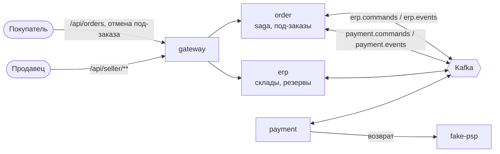

# System Design 03: Склад (этап 3)

**Статус:** ✅ Реализовано · **Дата:** 2026-10-23 · **Ревизия:** 2

Этап 3 из ТЗ (раздел 8): сервис erp и полная saga оформления с резервом по складам продавцов. Сюда же входит жизнь под-заказа после подтверждения: отгрузка, доставка, отмена. Правила уже заданы в ADR-0005 (saga, п. 4–9), ADR-0006 (кабинет продавца, изоляция) и ADR-0004 (своя база). Здесь — что именно строим и как проверяем.

## 1. Критерий готовности

ТЗ, раздел 8: «Полная saga с резервом по складам продавцов; TTL; отгрузка списывает остаток; отмена под-заказа снимает резерв; `stock.low`». Сценарии — из ADR-0005, п. 11 и ADR-0006, п. 8. Сценарии этапа 2 остаются и проходят с резервом.

| #   | Сценарий                                                          | Ожидаемый результат                                                                          |
| --- | ----------------------------------------------------------------- | -------------------------------------------------------------------------------------------- |
| 1   | Заказ у двух продавцов, оплата прошла                             | `CONFIRMED`; резервы на складах обоих продавцов закреплены; деньги списаны                    |
| 2   | У одного из продавцов не хватает товара                           | `CANCELLED` (`out_of_stock`), оплата не запрашивалась, остатки не изменились                   |
| 3   | Покупатель не заплатил                                            | `CANCELLED` по дедлайну, резерв снят, `available` вернулся                                     |
| 4   | Покупатель заплатил после дедлайна                                | `CANCELLED`, авторизация снята, резерв снят                                                   |
| 5   | Закрепление резерва не удалось после авторизации                  | `CANCELLED` (`out_of_stock`), авторизация снята, деньги не списывались                         |
| 6   | Каждое сообщение saga доставлено дважды                           | Как сценарий 1                                                                                 |
| 7   | erp недоступна во время `CommitStock`                             | После восстановления — `CONFIRMED`                                                            |
| 8   | Незакреплённый резерв живёт дольше TTL (order не ответил)         | erp снимает его сам и публикует `stock.released`                                               |
| 9   | Продавец отгружает под-заказ                                      | `SHIPPED`; `on_hand` и `reserved` уменьшились на количество под-заказа                          |
| 10  | Продавец отменяет свой под-заказ                                  | Резерв снят, возврат суммы под-заказа у провайдера, второй под-заказ не затронут               |
| 11  | Покупатель отменяет под-заказ до отгрузки; после отгрузки — нельзя | Как сценарий 10; после отгрузки — `409`                                                        |
| 12  | Отгрузка и отмена одного под-заказа одновременно                  | Проходит ровно одно действие                                                                  |
| 13  | Остаток опустился до порога                                        | `stock.low` один раз на пересечение порога                                                     |
| 14  | Изоляция кабинета                                                 | Продавец B на ресурсы продавца A — `404`; сотрудник без права — `403`; для всех эндпоинтов `@SellerScope` |
| 15  | Сценарии 1–3, 5–12 этапа 2                                         | Проходят, как раньше                                                                          |

Плюс: CI зелёный, job `e2e` с новыми сценариями.

## 2. Что входит и что нет

**Входит:**

- `apps/erp` (полный шаблон): склады продавца, остатки, резервы с TTL, ответы saga, списание при отгрузке, `stock.low`, реестр продаж.
- order: полная saga (`RESERVING`, `COMMITTING`), действия с под-заказом, кабинет продавца для под-заказов.
- payment: `RefundPayment` — возврат суммы под-заказа у провайдера (п. 7 и решение 1).
- fake-psp: возврат (`POST /v1/payments/:id/refund`) с частичной суммой.
- `libs/auth`: `@SellerScope(permission)` и область продавца (ADR-0006, п. 5).
- gateway: маршруты к erp и под-заказам.
- Контракты команд и событий склада и под-заказа.

**Не входит:**

- Проводки, комиссия, удержание, выплаты — этап 4 (ADR-0007). Возврат на этапе 3 — только деньги у провайдера, без журнала (решение 1).
- `stock.level-changed`: его читает catalog — этап 5.
- Поставки, инвентаризация, частичный резерв, возвраты после доставки — после MVP (ТЗ, 3.3, 3.4).
- UI кабинета — этап 7. Кабинет на этом этапе — REST через gateway.

## 3. Сервисы



| Сервис    | Новое на этапе 3                                                                                         |
| --------- | -------------------------------------------------------------------------------------------------------- |
| `erp`     | Новый, полный шаблон, `erp_db`. Читает `erp.commands`, `order.events`; публикует `erp.events`            |
| `order`   | Полная saga, под-заказы, кабинет; читает ещё `erp.events`; публикует `erp.commands`, `sub-order.*`        |
| `payment` | `RefundPayment`, событие `payment.refunded`                                                              |
| `fake-psp`| Возврат                                                                                                   |
| `gateway` | `/api/seller/sub-orders/**` → order, `/api/seller/warehouses/**` и `/api/seller/stock/**` → erp            |

## 4. Контракты

В `libs/contracts`, по ADR-0002 и ADR-0003.

**Команды** `erp.commands` (ключ `orderId`, retention 7 дней):

| Команда           | Payload                                                                                   |
| ----------------- | ----------------------------------------------------------------------------------------- |
| `ReserveStock` v1 | `orderId`, `lines: [{ subOrderId, sellerId, skuId, qty }]`                                 |
| `CommitStock` v1  | `orderId`                                                                                 |
| `ReleaseStock` v1 | `orderId`, `subOrderId?` — без него снимается весь резерв заказа                           |

**Команда** `payment.commands`: `RefundPayment` v1 — `orderId`, `subOrderId`. Сумму payment берёт из своей записи о списании, а не из команды (ADR-0005, п. 8).

**События** `erp.events` (ключ `orderId`): `stock.reserved`, `stock.rejected { unavailable: [skuId] }`, `stock.committed`, `stock.commit-failed { unavailable }`, `stock.released { subOrderId?, reason: requested | expired }`. `stock.low` — ключ `skuId`: `{ sellerId, skuId, available, threshold }`.

**События** `order.events` (ключ `orderId`, общая версия заказа): `sub-order.shipped`, `sub-order.delivered`, `sub-order.cancelled { cancelledBy: buyer | seller }`. Каждое несёт `subOrderId`, `sellerId` и позиции — erp списывает и сторнирует по ним без запросов к order.

**События** `payment.events`: `payment.refunded { subOrderId, amount }`.

**Топики:** `erp.commands` (6, 7 дней), `erp.events` (6, `-1`); DLQ `erp-service.dlq` (генератор).

**Тестовые данные** — `libs/contracts/src/dev/fixtures.ts`: склады магазинов A и B с приоритетами, начальные остатки seed-каталога, сотрудник `manager-a` с одним правом `orders` — для проверок `403`.

## 5. erp

Полная схема слоёв (SD-00, п. 8).

### 5.1 Данные

```sql
catalog_skus  (sku_id uuid PK, seller_id uuid)             -- read-model: чей SKU (seed до этапа 5)
warehouses    (warehouse_id uuid PK, seller_id uuid, name text, priority int, active bool,
               UNIQUE (seller_id, name))
stock         (warehouse_id uuid, sku_id uuid, seller_id uuid,
               on_hand int CHECK (on_hand >= 0), reserved int CHECK (reserved >= 0 AND reserved <= on_hand),
               PRIMARY KEY (warehouse_id, sku_id))
stock_thresholds (seller_id uuid, sku_id uuid PK, low_threshold int, low_notified bool)
reservations  (order_id uuid, sub_order_id uuid, sku_id uuid, warehouse_id uuid, seller_id uuid, qty int,
               status text,          -- RESERVED, COMMITTED, RELEASED, SHIPPED
               expires_at timestamptz,   -- только у RESERVED: TTL
               PRIMARY KEY (order_id, sku_id))
reserve_results (order_id uuid PK, outcome text, unavailable uuid[])  -- повтор ReserveStock отвечает тем же
sales         (sub_order_id uuid PK, order_id uuid, seller_id uuid, amount_minor bigint, lines jsonb,
               confirmed_at timestamptz, reversed_at timestamptz)   -- реестр продаж, сторно — отметкой
```

`seller_id` — в каждой таблице с данными продавца, индексы начинаются с него (ADR-0006, п. 5). Seed складов и остатков — как в order: `dist/seed.js` в шаге `erp-migrate` при `SEED_STOCK=true`.

### 5.2 Команды saga

По ADR-0005, п. 8. Каждая команда — одна транзакция, ответ — в outbox. Идемпотентность — по состоянию резерва, как у payment: повтор отвечает тем же результатом.

| Команда        | Что делает                                                                                                                                                         | Ответ                                       |
| -------------- | ------------------------------------------------------------------------------------------------------------------------------------------------------------------ | ------------------------------------------- |
| `ReserveStock` | Всё или ничего по всему заказу. Каждая позиция — на первом по приоритету складе своего продавца, где хватает `available`. Строки `stock` блокируются в порядке `(warehouse_id, sku_id)` | `stock.reserved` или `stock.rejected`       |
| `CommitStock`  | Резерв `RESERVED` → `COMMITTED`, TTL снимается. Резерв уже снят по TTL — попытка зарезервировать заново; не вышло — `stock.commit-failed`                           | `stock.committed` или `stock.commit-failed` |
| `ReleaseStock` | Снимает `RESERVED` и `COMMITTED` (всего заказа или одного под-заказа), не трогает `SHIPPED`                                                                         | `stock.released`                            |

- Повтор `ReserveStock` — ответ из `reserve_results`, остаток второй раз не резервируется.
- Команда для неизвестного или завершённого резерва ничего не меняет и отвечает текущим статусом (ADR-0005, п. 8).
- `UPDATE stock SET reserved = reserved + $qty WHERE … AND on_hand - reserved >= $qty`: 0 строк — товара не хватает, транзакция откатывается целиком.

### 5.3 TTL резерва

Планировщик раз в `RESERVE_SWEEP_MS` снимает `RESERVED` с `expires_at < now()` (`FOR UPDATE SKIP LOCKED`, транзакция на заказ) и публикует `stock.released { reason: expired }`. TTL — `RESERVE_TTL_MS`, 30 мин (ТЗ, 3.4). Он больше дедлайна оплаты (15 мин): если order жив, он сам отменит заказ раньше.

### 5.4 События заказа

| Событие               | Что делает erp                                                                                   |
| --------------------- | ------------------------------------------------------------------------------------------------ |
| `order.confirmed`     | Строки `sales` по под-заказам — реестр продаж (ТЗ, 3.4)                                          |
| `sub-order.shipped`   | Резерв под-заказа `COMMITTED` → `SHIPPED`: `on_hand -= qty`, `reserved -= qty`; проверка `stock.low` |
| `sub-order.cancelled` | Сторно продажи: `sales.reversed_at`. Резерв снимает `ReleaseStock` от order, а не это событие      |

Обработчики — с `processed_events` (ADR-0002, п. 7).

### 5.5 `stock.low`

Порог задаёт продавец на SKU (сумма по его складам). После резерва, отгрузки и ручного изменения остатка erp сравнивает `available` с порогом. Событие — один раз при пересечении сверху вниз (`low_notified`); флаг сбрасывается, когда остаток поднимается выше порога. Без порога событий нет.

### 5.6 Кабинет продавца

Через gateway `/api/seller/**`. Область продавца — из токена (`@SellerScope('warehouse')`), репозитории фильтруют по `seller_id` (ADR-0006, п. 5).

| Запрос                                  | Что делает                                                                                   |
| --------------------------------------- | -------------------------------------------------------------------------------------------- |
| `GET/POST /seller/warehouses`           | Свои склады; создать склад                                                                   |
| `PATCH /seller/warehouses/:id`          | Название, приоритет, активность                                                              |
| `GET /seller/stock`                     | Остатки по SKU и складам: `on_hand`, `reserved`, `available`                                 |
| `POST /seller/stock/adjustments`        | Приход или списание на складе: `{ warehouseId, skuId, delta, reason }`; ниже `reserved` — `409` |
| `PUT /seller/stock/:skuId/threshold`    | Порог `stock.low`                                                                            |

SKU чужого продавца — `404`, как чужой склад: это проверяет read-model `catalog_skus`.

## 6. order

### 6.1 Полная saga

Таблица ADR-0005, п. 4 целиком. Изменения против этапа 2 (SD-02, п. 5.2):

| Состояние          | Вход                     | Новое состояние    | Команды                                          | Событие заказа                          |
| ------------------ | ------------------------ | ------------------ | ------------------------------------------------ | --------------------------------------- |
| —                  | `POST /orders`           | `RESERVING`        | `ReserveStock`                                   | `order.created`                         |
| `RESERVING`        | `stock.reserved`         | `AWAITING_PAYMENT` | `CreatePayment`                                  | —                                       |
| `RESERVING`        | `stock.rejected`         | `CANCELLED`        | —                                                | `order.cancelled` (`out_of_stock`)      |
| `RESERVING`        | дедлайн резерва (30 с)   | `CANCELLED`        | `ReleaseStock`                                   | `order.cancelled` (`reservation_timeout`) |
| `AWAITING_PAYMENT` | `payment.authorized`     | `COMMITTING`       | `CommitStock`                                    | —                                       |
| `AWAITING_PAYMENT` | `payment.failed`, дедлайн | `CANCELLED`       | + `ReleaseStock`                                 | как на этапе 2                          |
| `COMMITTING`       | `stock.committed`        | `CAPTURING`        | `CapturePayment`                                 | —                                       |
| `COMMITTING`       | `stock.commit-failed`    | `CANCELLED`        | `CancelPayment`, `ReleaseStock`                  | `order.cancelled` (`out_of_stock`)      |
| `COMMITTING`       | дедлайн (5 мин)          | без изменений      | `CommitStock` повторно + алерт                   | —                                       |
| `CAPTURING`        | `payment.capture-failed` | `CANCELLED`        | `CancelPayment`, + `ReleaseStock`                | `order.cancelled` (`capture_failed`)    |
| `CANCELLED`        | `stock.reserved`         | без изменений      | `ReleaseStock`                                   | —                                       |
| финальное          | `stock.released`         | без изменений      | — (результат компенсации в лог)                  | —                                       |

Остальные строки — как на этапе 2. `transition` остаётся чистой функцией, тест на каждую строку.

### 6.2 Под-заказ после подтверждения

ADR-0005, п. 5. Действие блокирует строку saga, затем строку под-заказа (п. 7): события разных под-заказов получают разные версии заказа, а отгрузка и отмена одного под-заказа не проходят обе.

| Действие          | Кто                               | Переход                 | Команды                                         | Событие               |
| ----------------- | --------------------------------- | ----------------------- | ----------------------------------------------- | --------------------- |
| Отгрузить         | продавец (`orders`)               | `CONFIRMED → SHIPPED`   | —                                               | `sub-order.shipped`   |
| Отметить доставку | продавец (`orders`)               | `SHIPPED → DELIVERED`   | —                                               | `sub-order.delivered` |
| Отменить          | покупатель или продавец (`orders`) | `CONFIRMED → CANCELLED` | `ReleaseStock { subOrderId }`, `RefundPayment { subOrderId }` | `sub-order.cancelled` |

- Повтор выполненного действия — `200` и текущий статус; недопустимый переход — `409` (ADR-0005, п. 9).
- `stock.released` и `payment.refunded` по под-заказу order записывает в `sub_orders` (`refund_status`). Нет `payment.refunded` за `REFUND_ALERT_MS` (1 ч) — алерт от того же планировщика.

### 6.3 HTTP

| Запрос                                             | Кто                  |
| -------------------------------------------------- | -------------------- |
| `POST /orders/:orderId/sub-orders/:id/cancel`      | покупатель           |
| `GET /seller/sub-orders?status=&cursor=`           | продавец (`orders`)  |
| `GET /seller/sub-orders/:id`                       | продавец: позиции, получатель, адрес, телефон; email покупателя — нет (ADR-0006, п. 6) |
| `POST /seller/sub-orders/:id/ship | deliver | cancel` | продавец (`orders`)  |

Пути покупателя и продавца раздельные (решение 4).

## 7. payment и fake-psp

- `RefundPayment { orderId, subOrderId }`: допустимо из `CAPTURED`. Сумма — из разбивки, которую payment сохранил при `CapturePayment` (`payment_sub_orders`). Вызов провайдера — те же три шага, что у списания (SD-02, п. 6.2): `refunds` со статусом `REFUNDING` → `POST /v1/payments/:id/refund { amountMinor }` с ключом `<paymentId>:refund:<subOrderId>` → `REFUNDED` и `payment.refunded`.
- Повтор команды — повторно `payment.refunded`. Возврат сверх списанной суммы невозможен: ограничение в базе и проверка у провайдера.
- fake-psp: `refund` для `captured`, частичный, сумма возвратов ≤ суммы списания, счётчик `refunds` в тестовом API.

## 8. `libs/auth` и изоляция

- `@SellerScope(permission)` — область `{ kind: 'seller', sellerId, scopes }` из токена. Нет `sellerId` или роли продавца — `403`. Владелец (`seller`) имеет все права; сотрудник (`seller_manager`) — только выданные, без нужного права — `403`.
- Декоратор пишет метаданные. Тест изоляции собирает из них список эндпоинтов кабинета и для каждого проверяет: продавец B на ресурс A — `404`, сотрудник без права — `403` (ADR-0006, п. 8). Новый эндпоинт попадает в проверку сам.

## 9. Тестирование

| Уровень                         | Что                                                                                                                                                                                    |
| ------------------------------- | -------------------------------------------------------------------------------------------------------------------------------------------------------------------------------------- |
| Unit                            | `transition` — строка таблиц п. 6.1 = тест; переходы под-заказа (п. 6.2); выбор склада по приоритету; `stock.low` на пересечении порога; `@SellerScope`                                |
| Интеграционные (Testcontainers) | erp: два заказа на последний товар одновременно — резерв у одного; повтор `ReserveStock` — тот же ответ; TTL снимает резерв; commit после TTL. order: отгрузка и отмена одного под-заказа одновременно — одно действие; действия с разными под-заказами — версии N+1 и N+2. payment: повтор `RefundPayment` — один возврат у провайдера |
| Контрактные                     | Фикстуры всех новых сообщений (SD-01, п. 8)                                                                                                                                            |
| E2E                             | Сценарии п. 1 и тест изоляции кабинета; TTL и дедлайны — секунды в `compose.e2e.yaml`                                                                                                  |

## 10. Решения (согласовано)

1. **Возврат при отмене под-заказа — на этапе 3, без проводок.** Критерий этапа требует отмены под-заказа, а отмена без возврата нарушила бы правило ТЗ (раздел 5): каждое списание заканчивается подтверждённым под-заказом или возвратом. Поэтому `RefundPayment` и возврат у провайдера появляются сейчас, а проводки к ним (ADR-0007, операции 3–4) — на этапе 4. _Альтернатива:_ перенести отмену под-заказа целиком на этап 4 — тогда критерий этапа 3 «отмена снимает резерв» не выполняется.
2. **Реестр продаж erp — на этапе 3.** Он по ТЗ (3.4) принадлежит erp, а критерий этапа 4 сверяет с ним баланс продавца. Без него этапу 4 не с чем сверяться.
3. **`stock.level-changed` — на этапе 5**, вместе с catalog: до этого событие никто не читает.
4. **Раздельные пути покупателя и продавца для под-заказов** (`/orders/:orderId/sub-orders/:id/cancel` и `/seller/sub-orders/:id/…`) вместо общего `/sub-orders/:id/cancel` из ADR-0005, п. 9. Владелец магазина — тоже покупатель (роль `buyer` есть у всех), и по одному токену не понять, в какой роли он отменяет. ADR-0005, п. 9 правится.
5. **Дедлайн резерва в e2e** — секунды, TTL резерва — тоже, чтобы проверить сценарий 8 без ожидания 30 минут.

## 11. Порядок работ

1. Контракты: команды и события склада, под-заказа, возврата; fixtures (склады, остатки, `manager-a`); топики.
2. `libs/auth`: `@SellerScope`, метаданные для теста изоляции.
3. `apps/erp`: склады, остатки, резервы, команды saga, TTL, реестр продаж, `stock.low`, кабинет; интеграционные тесты.
4. fake-psp и payment: возврат.
5. order: полная saga, под-заказы, кабинет; интеграционные тесты.
6. gateway: маршруты.
7. e2e: сценарии п. 1, тест изоляции; CI.
8. CHANGELOG, SD-03 → «Реализовано», ТЗ: этап 3 ✅; ADR-0005 (п. 9, пути), SD-00 (erp).

## 12. Итог

Все сценарии п. 1 проходят в CI job `e2e`: 9 сценариев этапа 3 (`warehouse.e2e-spec.ts`) и 10 сценариев этапа 2 — уже с резервом. Сценарий 6 (дубли сообщений saga) проверяют интеграционные тесты order и erp и e2e-сценарий дублей webhook этапа 2. Уточнения по ходу реализации:

- **Изоляция кабинета.** Интеграционные тесты erp и order обходят все эндпоинты `@SellerScope` из метаданных и ждут `403` для сотрудника без права. Проверки `404` для чужого продавца требуют настоящих ресурсов, поэтому они перечислены в e2e явно.
- **`stock.low` в e2e** проверяется через флаг `low` в `GET /seller/stock`: событие уходит в Kafka, читателя у него до этапа 6 (notification) нет.
- **Отгрузка списывает остаток без `processed_events`.** Идемпотентность держится на статусе резерва: списывается только `COMMITTED`, повтор события видит `SHIPPED`. Отметка «обработано» в отдельной транзакции могла бы потерять списание при сбое.
- **Курсор списка под-заказов продавца** — id последнего под-заказа: UUID v7 растут со временем.
- **E2E:** TTL резерва на стенде — 45 с, меньше дедлайна оплаты (120 с). Поэтому в долгих сценариях этапа 2 резерв истекает, и закрепление резервирует товар заново — этот путь тоже проверяется.
