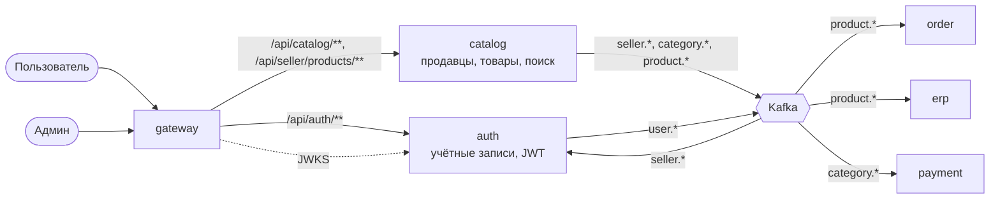

# System Design 05: Продавцы и каталог (этап 5)

**Статус:** 📝 На согласовании · **Дата:** 2026-10-23 · **Ревизия:** 1

Этап 5 из ТЗ (раздел 8): сервисы auth и catalog. Они заменяют заглушки ранних этапов — вход через `/dev/login` в gateway и seed-товары в read-моделях order, erp и payment (SD-00, п. 144). Правила заданы в ADR-0001 (границы), ADR-0006 (арендаторы, роли, токен, изоляция) и ТЗ, 3.1–3.2.

## 1. Критерий готовности

ТЗ, раздел 8: «Регистрация, роли, модерация продавцов и товаров, поиск. Read-model товаров в order строится по `product.*`. Тесты изоляции: продавец B получает 404 на ресурсы продавца A».

| #   | Сценарий                                                              | Ожидаемый результат                                                                                     |
| --- | --------------------------------------------------------------------- | ------------------------------------------------------------------------------------------------------- |
| 1   | Регистрация, вход, обновление токена                                  | Токены выдаются; refresh ротируется; повтор старого refresh отзывает всё семейство — оба токена дают `401` |
| 2   | Пользователь регистрирует магазин                                     | Магазин `pending`; после обновления токена — роль `seller` и кабинет; опубликовать товар нельзя         |
| 3   | Админ одобряет магазин; продавец создаёт товар с SKU, отправляет на модерацию; админ одобряет | Товар опубликован; `product.published` строит read-model в order и erp; покупатель заказывает его до `CONFIRMED` |
| 4   | Админ отклоняет товар                                                 | Товара нет в поиске; заказать его нельзя (`422`)                                                         |
| 5   | Админ блокирует магазин                                               | Товары сняты с публикации; заказать нельзя; права кабинета исчезают после обновления токена             |
| 6   | Поиск                                                                 | Находит по-русски, по-узбекски латиницей и кириллицей; фильтры по категории и цене; курсорная пагинация |
| 7   | Владелец добавляет сотрудника с правом `catalog`                      | После обновления токена сотрудник правит товары, а в склады — `403`                                      |
| 8   | Изоляция                                                              | Продавец B на товары, SKU, склады, заказы, финансы продавца A — `404`; каждый эндпоинт `@SellerScope` — `403` без права |
| 9   | Админ создаёт категорию                                               | `category.created` доходит до payment: ставку комиссии для неё можно задать                              |
| 10  | Сценарии этапов 2–4                                                   | Проходят со входом через auth и каталогом из catalog                                                     |

## 2. Что входит и что нет

**Входит:**

- `apps/auth` — учётные записи, вход, токены, членство в магазине и права сотрудников.
- `apps/catalog` — продавцы и модерация, дерево категорий, товары и SKU, модерация товаров, поиск.
- Read-модели по событиям: order и erp — из `product.*`, payment — из `category.*`, auth — из `seller.*`.
- gateway: маршруты к auth и catalog; ключи JWT — из auth; заглушка `/dev/login` удаляется.
- Контракты событий `user.*`, `seller.*`, `category.*`, `product.*`.

**Не входит:**

- Вход по телефону, мгновенный отзыв доступа, загрузка изображений, рейтинг продавца — после MVP (ТЗ, 3.1–3.2).
- `stock.level-changed` и наличие на витрине — вместе со storefront (этап 7).
- Письма о регистрации и модерации — этап 6 (notification). События для них появляются сейчас.

## 3. Сервисы



| Сервис    | Схема слоёв | База         | Публикует                       | Читает                          |
| --------- | ----------- | ------------ | ------------------------------- | ------------------------------- |
| `auth`    | полная      | `auth_db`    | `auth.events`: `user.registered` | `catalog.events`: `seller.*`    |
| `catalog` | полная      | `catalog_db` | `catalog.events`: `seller.*`, `category.*`, `product.*` | — |

Обе базы уже заведены в `infra/postgres/services.txt` (SD-01).

## 4. Контракты

`catalog.events` (6 партиций, бессрочно) и `auth.events` — в `topics.conf`.

| Событие                                        | Ключ         | Payload                                                                                       |
| ---------------------------------------------- | ------------ | --------------------------------------------------------------------------------------------- |
| `user.registered` v1                           | `userId`     | `userId`, `email`                                                                             |
| `seller.registered` v1                         | `sellerId`   | `sellerId`, `ownerUserId`, `name`                                                             |
| `seller.approved`, `seller.rejected`, `seller.blocked` v1 | `sellerId` | `sellerId`, `reason?`                                                                  |
| `category.created`, `category.updated` v1      | `categoryId` | `categoryId`, `parentId`, `name`, `path` (от корня)                                            |
| `product.published` v1                         | `productId`  | `productId`, `sellerId`, `title`, `categoryPath`, `skus: [{ skuId, skuCode, price, active }]` — состояние целиком |
| `product.unpublished` v1                       | `productId`  | `productId`, `sellerId`, `reason` (`rejected_change`, `seller_blocked`, `archived`)            |

- `product.published` несёт товар целиком, а не изменение: read-модель просто заменяет строки товара (ADR-0004, п. 3). Повтор и порядок обеспечивают ключ `productId` и проверка `aggregateVersion`.
- Цена или активность SKU у опубликованного товара меняется сразу — новым `product.published`.

## 5. auth

### 5.1 Данные

```sql
users           (user_id uuid PK, email citext UNIQUE, password_hash text, is_admin bool, created_at)
memberships     (user_id uuid PK, seller_id uuid, role text,       -- seller | seller_manager
                 scopes text[], seller_status text)                 -- из seller.*: pending | active | rejected | blocked
refresh_tokens  (token_id uuid PK, family_id uuid, user_id uuid, token_hash text,
                 expires_at timestamptz, used_at timestamptz, revoked_at timestamptz)
signing_keys    (kid text PK, private_jwk jsonb, public_jwk jsonb, created_at, active bool)
```

- Пароли — argon2id (ТЗ, 3.1). Email хранится в нижнем регистре.
- В MVP пользователь состоит не больше чем в одном магазине (ADR-0006, п. 1): `memberships.user_id` — первичный ключ.

### 5.2 Токены

- **Access** — 15 минут, EdDSA, claims по ADR-0006, п. 3. Роль `buyer` есть у всех; `seller`/`seller_manager`, `sellerId` и `scopes` — только при магазине в `pending` или `active`; у `rejected` и `blocked` их нет. `admin` — по `users.is_admin`.
- **Refresh** — 7 дней, непрозрачная случайная строка, в базе только SHA-256. Каждый `POST /auth/refresh` гасит текущий токен и выдаёт новый того же семейства. Предъявлен уже использованный — отзывается всё семейство (ТЗ, 3.1): кража токена обнаруживается при первом же повторе.
- **Ключ подписи** создаётся при первом старте и хранится в `signing_keys` (решение 1). JWKS — `GET /.well-known/jwks.json`, его читают gateway и все сервисы через `libs/auth`.

### 5.3 API

| Запрос                                   | Кто              | Что делает                                                              |
| ---------------------------------------- | ---------------- | ----------------------------------------------------------------------- |
| `POST /auth/register`                    | аноним           | Учётная запись, `user.registered`; `409` — email занят                  |
| `POST /auth/login`                       | аноним           | Пара токенов; неверный email или пароль — одинаковый `401`              |
| `POST /auth/refresh`                     | аноним с refresh | Ротация (п. 5.2)                                                        |
| `POST /auth/logout`                      | аноним с refresh | Отзыв семейства                                                         |
| `GET /auth/me`                           | любой            | Профиль и текущие роли                                                  |
| `GET/POST/PUT/DELETE /seller/staff[/:userId]` | владелец (`staff`) | Сотрудники магазина и их права (решение 2)                     |

- Лимит попыток входа — общий rate limit gateway; блокировка учётной записи после N неудач — после MVP.
- Первый админ — из env `ADMIN_EMAIL`, `ADMIN_PASSWORD` при старте (решение 5).

### 5.4 События

- `seller.registered` → членство владельца (`role: seller`, все права, `seller_status: pending`).
- `seller.approved | rejected | blocked` → `seller_status`. Права в токене меняются при следующем обновлении (ADR-0006, п. 3).

## 6. catalog

### 6.1 Данные

```sql
sellers      (seller_id uuid PK, owner_user_id uuid UNIQUE, name text, status text,   -- pending | active | rejected | blocked
              reason text, created_at, version int)
categories   (category_id uuid PK, parent_id uuid, name text, path uuid[], version int)
products     (product_id uuid PK, seller_id uuid, title text, description text, category_id uuid,
              images text[], status text,                    -- draft | on_review | published | rejected | archived
              rejection_reason text, search tsvector, version int, created_at, updated_at)
skus         (sku_id uuid PK, product_id uuid, seller_id uuid, sku_code text, attributes jsonb,
              price_minor bigint, active bool, UNIQUE (seller_id, sku_code))   -- ADR-0006, п. 5
```

Индексы по `seller_id` первыми; GIN по `search`.

### 6.2 Продавцы

| Действие                     | Кто                  | Переход                           | Событие             |
| ---------------------------- | -------------------- | --------------------------------- | ------------------- |
| `POST /sellers`              | пользователь без магазина | → `pending`                  | `seller.registered` |
| `POST /admin/sellers/:id/approve` | админ           | `pending → active`                | `seller.approved`   |
| `POST /admin/sellers/:id/reject`  | админ           | `pending → rejected`              | `seller.rejected`   |
| `POST /admin/sellers/:id/block`   | админ           | `active → blocked`                | `seller.blocked`; все товары — `product.unpublished (seller_blocked)` |

### 6.3 Товары и модерация

| Действие                                  | Кто                   | Переход                                 | Событие               |
| ----------------------------------------- | --------------------- | --------------------------------------- | --------------------- |
| Создать, править черновик, SKU            | продавец (`catalog`)  | `draft`                                 | —                     |
| Отправить на модерацию                    | продавец (`catalog`)  | `draft`, `rejected` → `on_review`       | —                     |
| Одобрить                                  | админ                 | `on_review → published` (магазин `active`, иначе `409`) | `product.published` |
| Отклонить                                 | админ                 | `on_review → rejected`                  | —                     |
| Изменить текст, категорию, SKU опубликованного | продавец         | `published → on_review`                  | `product.unpublished (rejected_change)` до повторного одобрения (решение 3) |
| Изменить цену или активность SKU опубликованного | продавец       | без изменений                           | `product.published`   |
| Архивировать                              | продавец              | → `archived`                            | `product.unpublished (archived)` |

- Переходы — чистая функция в `domain`, по тесту на строку.
- Кабинет: `/seller/products/**` с `@SellerScope('catalog')`; админка: `/admin/sellers/**`, `/admin/products/**`, `/admin/categories/**` с `@Admin()`.

### 6.4 Поиск

- `GET /catalog/search?q&categoryId&minPrice&maxPrice&cursor` — публичный, только опубликованные товары активных продавцов. Курсор — по рангу и `product_id`.
- `search` = `setweight(to_tsvector('russian', title), 'A') || setweight(to_tsvector('simple', translit(title)), 'A') || то же для описания с весом `B`. `translit` — транслитерация узбекской кириллицы в латиницу в коде приложения: в индексе обе формы, запрос тоже приводится к латинице (решение 4). Русский — со стеммингом `russian`, узбекский — словарём `simple`.
- Категория фильтрует по поддереву: `categoryId = ANY(path)`.
- `GET /catalog/products/:id` — карточка опубликованного товара; `GET /catalog/categories` — дерево.

## 7. Потребители и переход с заглушек

| Где      | Сейчас (этапы 2–4)                         | Этап 5                                                                                           |
| -------- | ------------------------------------------ | ------------------------------------------------------------------------------------------------ |
| gateway  | `DevTokenIssuer`, `/dev/login`, свои ключи | Ключи из JWKS auth; `/dev/login` и `DEV_AUTH` удаляются; `DevTokenIssuer` остаётся только в тестах |
| order    | `catalog_skus` — seed                      | `product.published` заменяет SKU товара, `product.unpublished` деактивирует; заказать снятый — `422` |
| erp      | `catalog_skus` — seed                      | `product.*`: чей SKU — для проверки кабинета                                                      |
| payment  | `categories` — seed                        | `category.created | updated`                                                                     |
| e2e      | `/dev/login`                               | `/api/auth/login` тестовыми пользователями                                                        |

- **Демо-данные** (решение 6): тестовые пользователи, магазины A и B, категории и товары из `libs/contracts/src/dev` создаёт seed в auth и catalog — через обычные события. Read-модели order, erp и payment наполняются ими же, поэтому их seed удаляется. Склады и остатки остаются seed erp: это данные продавца, а не каталога.
- Id из fixtures сохраняются: сценарии этапов 2–4 не меняются, кроме входа.

## 8. Тестирование

| Уровень                         | Что                                                                                                                                         |
| ------------------------------- | ------------------------------------------------------------------------------------------------------------------------------------------- |
| Unit                            | Ротация и повтор refresh; claims по статусу магазина; переходы продавца и товара (строка = тест); транслитерация; права сотрудников        |
| Интеграционные (Testcontainers) | auth: повтор refresh отзывает семейство, одновременные обновления одним токеном — проходит одно; catalog: поиск на настоящем Postgres (ru, uz-латиница, uz-кириллица, фильтры, курсор); блокировка магазина снимает товары; read-модель order по `product.*` |
| E2E                             | Сценарии п. 1; изоляция кабинета для каталога                                                                                               |

## 9. Решения на согласование

1. **Ключ подписи — в базе auth**, создаётся при первом старте; JWKS отдаёт активный ключ. Ротация ключей — после MVP. _Альтернатива:_ ключ из секрета в env — проще, но тогда его надо заранее сгенерировать для каждого стенда.
2. **Сотрудники — без приглашений по почте.** Владелец добавляет уже зарегистрированного пользователя по email и сразу выдаёт права. Письмо-приглашение появится с notification (этап 6).
3. **Изменение опубликованного товара.** Цена и активность SKU применяются сразу. Текст, категория и состав SKU снимают товар с публикации до повторной модерации: витрина не показывает непроверенное. _Альтернатива:_ хранить опубликованную и черновую версии раздельно — правильнее, но вдвое сложнее модель.
4. **Узбекский поиск — словарь `simple` и транслитерация кириллицы в латиницу в коде.** Словаря узбекского для PostgreSQL нет; стемминга для узбекского не будет, совпадение — по словоформе и префиксу.
5. **Первый админ — из env** `ADMIN_EMAIL`, `ADMIN_PASSWORD`; остальные админы — после MVP.
6. **Демо-данные через seed auth и catalog, `libs/contracts/src/dev` остаётся источником** (ТЗ планировало удалить его на этапе 5). Тестовым пользователям — общий пароль из env `DEV_USER_PASSWORD`, только на локальном стенде и в e2e.

## 10. Порядок работ

1. Контракты `user.*`, `seller.*`, `category.*`, `product.*`; топики.
2. `apps/auth`: учётные записи, токены, JWKS, сотрудники, `seller.*`; тесты.
3. `apps/catalog`: продавцы, категории, товары, модерация, поиск; тесты.
4. Потребители: order, erp, payment — read-модели по событиям; удаление их seed.
5. gateway: маршруты, JWKS из auth, удаление `/dev/login`; e2e — вход через auth.
6. e2e: сценарии п. 1.
7. CHANGELOG, SD-05 → «Реализовано», ТЗ: этап 5 ✅, SD-00, ADR-0006 (сотрудники без приглашений).
