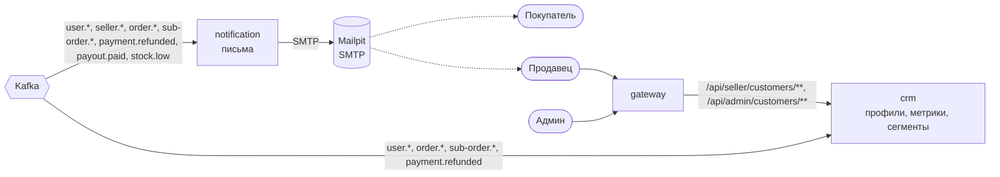

# System Design 06: CRM и уведомления (этап 6)

**Статус:** ✅ Реализовано · **Дата:** 2026-10-24 · **Ревизия:** 2

Этап 6 из ТЗ (раздел 8): сервисы crm и notification. Оба только читают события других сервисов (ТЗ, раздел 4) и своих событий пока не публикуют (SD-00, п. 3). Правила заданы в ADR-0002 (идемпотентность, replay), ADR-0004 (read-модели, порядок событий), ADR-0006 (данные покупателя у продавца) и ТЗ, 3.6–3.7.

## 1. Критерий готовности

ТЗ, раздел 8: «Профиль 360°, метрики, сегменты; replay пересобирает сегменты; письма по событиям в Mailpit».

| #   | Сценарий                                                                 | Ожидаемый результат                                                                                                     |
| --- | ------------------------------------------------------------------------ | ----------------------------------------------------------------------------------------------------------------------- |
| 1   | Покупатель оплатил заказ у двух продавцов                                | Профиль в crm: заказ в таймлайне, LTV, средний чек, частота, сегмент `new`. Письма: покупателю «заказ подтверждён», каждому продавцу «новый заказ» |
| 2   | Продавец отгрузил и доставил под-заказ                                   | Таймлайн обновлён; покупателю письма «отгружен» и «доставлен»                                                           |
| 3   | Покупатель отменил под-заказ после оплаты                                | LTV уменьшился на сумму под-заказа; письма «под-заказ отменён» и «деньги возвращены»                                    |
| 4   | Оформление отменено: товара нет                                          | Таймлайн: отмена с причиной `out_of_stock` («потерянная продажа»); письмо «заказ отменён»                               |
| 5   | Сегменты                                                                 | Второй заказ — `regular`; LTV выше порога — `vip`; нет заказов дольше порога — `sleeping` (на стенде порог — секунды)   |
| 6   | CRM продавца                                                             | Только покупатели с заказами в его магазине и только эти заказы, без email; чужой покупатель — `404`; без права `support` — `403` |
| 7   | Низкий остаток, выплата, решения модерации                               | Владельцу магазина письма «остаток заканчивается», «выплата прошла», «магазин на модерации / одобрен / отклонён»       |
| 8   | Повтор события; почтовый сервер недоступен                               | Дубль события — одно письмо; Mailpit остановлен — письма уходят после его запуска                                      |
| 9   | Replay crm                                                               | Проекции очищены, offset сброшены; после пересборки профили, метрики и сегменты совпадают с прежними                     |
| 10  | Сценарии этапов 2–5                                                      | Проходят                                                                                                                |

## 2. Что входит и что нет

**Входит:**

- `apps/crm` — профиль покупателя 360°, метрики, сегменты по фиксированным правилам, CRM продавца, отчёт админки по сегментам, replay проекций.
- `apps/notification` — письма по событиям через SMTP (локально — Mailpit), шаблоны на русском с ключами i18n.
- gateway: маршруты `/api/seller/customers/**` и `/api/admin/customers/**`, `/api/admin/reports/segments` — в crm.
- seed auth публикует `user.registered` для тестовых пользователей (решение 7).

**Не входит** (ТЗ, 3.6–3.7, после MVP):

- Тикеты, отзывы и NPS, подписки «снова в наличии», настраиваемые сегменты, персональные скидки и `customer.segment-changed`.
- Telegram и SMS; узбекские тексты писем (ключи закладываются сейчас).
- Письма сотрудникам магазина — только владельцу (решение 5).
- Названия товаров в письмах: письмо называет номер заказа, сумму и число позиций. Read-модель товаров в notification — когда понадобится.

## 3. Сервисы

| Сервис         | Схема слоёв | База              | Публикует | Читает                                                                                                                                           |
| -------------- | ----------- | ----------------- | --------- | ------------------------------------------------------------------------------------------------------------------------------------------------ |
| `crm`          | полная      | `crm_db`          | —         | `auth.events`: `user.registered`; `order.events`: `order.confirmed | cancelled`, `sub-order.*`; `payment.events`: `payment.refunded`                |
| `notification` | `--thin`    | `notification_db` | —         | `auth.events`: `user.registered`; `catalog.events`: `seller.*`; `order.events`: итоговые; `payment.events`: `payment.refunded`, `payout.paid`; `erp.events`: `stock.low` |

Обе базы уже заведены в `infra/postgres/services.txt` (SD-01). Новых топиков нет; DLQ — `crm-service.dlq`, `notification-service.dlq`. Группы обоих сервисов читают свои топики с начала (`fromBeginningTopics`, SD-05): иначе crm не увидит заказы до своего первого запуска, а notification — email пользователей.

Локальные порты: crm — 3106, notification — 3107.

## 4. Контракты

Новых событий нет. Используются существующие (SD-00, п. 3):

- `user.registered` — `userId`, `email`;
- `seller.registered` — `sellerId`, `ownerUserId`, `name`; `seller.approved | rejected | blocked`;
- `order.confirmed` — заказ с под-заказами (`subOrderId`, `sellerId`, `amount`, `lines`); `order.cancelled` — `buyerId`, `reason`;
- `sub-order.shipped | delivered | cancelled` — под-заказ целиком, `cancelledBy`;
- `payment.refunded` — `orderId`, `subOrderId`, `amount`;
- `payout.paid` — `payoutId`, `sellerId`, `amount`; `stock.low` — `sellerId`, `skuId`, `available`, `threshold`.

Время в обработчиках — `occurredAt` конверта, а не `now()` (ADR-0002, п. 9): replay даёт тот же результат.

## 5. crm

### 5.1 Данные

| Таблица           | Строка                 | Поля                                                                                         | Источник                                    |
| ----------------- | ---------------------- | -------------------------------------------------------------------------------------------- | ------------------------------------------- |
| `customers`       | покупатель             | `buyer_id`, `email` (может быть пусто), `registered_at`                                      | `user.registered`, любое событие заказа     |
| `customer_orders` | под-заказ              | `sub_order_id`, `order_id`, `buyer_id`, `seller_id`, `amount`, `status`, `confirmed_at`, `order_version` | `order.confirmed`, `sub-order.*`        |
| `timeline`        | событие в жизни клиента | `event_id`, `buyer_id`, `seller_id` (пусто — событие всего заказа), `order_id`, `kind`, `amount`, `reason`, `occurred_at` | все читаемые события                |

- Каждое событие делает upsert своих полей (ADR-0004, п. 3, правило 4): `order.confirmed` может прийти раньше `user.registered`, тогда email появится позже.
- Статус под-заказа меняется, только если версия заказа в событии больше сохранённой: повтор и опоздавшее событие ничего не меняют. Таймлайн — по `event_id` с `ON CONFLICT DO NOTHING`.
- `payment.refunded` пишет в таймлайн возврат; `order.cancelled` с `out_of_stock` помечается в таймлайне как потерянная продажа.

### 5.2 Метрики и сегменты

Метрики считаются запросом по `customer_orders` на момент чтения (решение 3):

- **LTV** — сумма подтверждённых под-заказов, кроме отменённых: отмена после оплаты возвращает деньги.
- **Средний чек** — LTV / число заказов. Для продавца заказ — его под-заказ.
- **Частота** — число заказов за последние 90 дней; **последний заказ** — `confirmed_at` самого нового.

Сегмент — чистая функция `segment(metrics, now, rules)` в `domain/` (решения 1–2), правила сверху вниз:

| Сегмент    | Правило (по умолчанию)                               |
| ---------- | ---------------------------------------------------- |
| `sleeping` | был хотя бы один заказ, последний — старше 90 дней   |
| `vip`      | LTV ≥ 5 000 000 сум                                  |
| `regular`  | 2 заказа и больше                                    |
| `new`      | остальные, включая покупателей без заказов           |

Пороги — в конфиге (`SEGMENT_SLEEPING_MS`, `SEGMENT_VIP_LTV_MINOR`, `SEGMENT_REGULAR_ORDERS`); e2e ставит порог «спящего» в секунды. Фильтр списка по сегменту — то же правило выражением SQL; unit-тест сверяет его с функцией на одних и тех же данных.

### 5.3 API

| Метод и путь                          | Доступ                     | Ответ                                                                                                  |
| ------------------------------------- | -------------------------- | ------------------------------------------------------------------------------------------------------ |
| `GET /seller/customers`               | `@SellerScope('support')`  | Покупатели с заказами в магазине: `buyerId`, метрики по магазину, сегмент; фильтр `segment`, курсор    |
| `GET /seller/customers/:buyerId`      | `@SellerScope('support')`  | Метрики, под-заказы и таймлайн только этого магазина, без email; нет заказов в магазине — `404`        |
| `GET /admin/customers`                | `@Admin()`                 | Все покупатели: email, метрики, сегмент; фильтры `segment`, `email`; курсор                             |
| `GET /admin/customers/:buyerId`       | `@Admin()`                 | Профиль 360°: email, метрики, заказы всех магазинов, оплаты и возвраты, таймлайн                        |
| `GET /admin/reports/segments`         | `@Admin()`                 | Число покупателей и сумма LTV по сегментам (решение 8)                                                  |

Продавец видит покупателя по `buyerId`; имя и адрес получателя — в под-заказе order, как и раньше (ADR-0006, п. 6).

### 5.4 Replay

Простая процедура ADR-0002, п. 9 (решение 6):

1. crm остановлен (в группе нет участников — иначе Kafka не даст сбросить offset).
2. `node dist/replay.js`: очищает `customers`, `customer_orders`, `timeline` и `processed_events` crm, сбрасывает offset группы `crm-service` на начало всех её топиков.
3. crm запущен и перечитывает события; проекция совпадает с прежней, потому что обработчики детерминированы.

В compose — сервис `crm-replay` (образ migrate, профиль `tools`), e2e запускает его через `docker compose run`.

## 6. notification

Схема слоёв `--thin` (SD-01): `handlers/ repositories/ api/` — правил предметной области почти нет, событие → письма.

### 6.1 Данные

| Таблица         | Поля                                                                                                                       | Источник                         |
| --------------- | -------------------------------------------------------------------------------------------------------------------------- | -------------------------------- |
| `recipients`    | `user_id`, `email`                                                                                                         | `user.registered`                |
| `shops`         | `seller_id`, `owner_user_id`, `name`                                                                                       | `seller.registered`              |
| `orders`        | `order_id`, `buyer_id`                                                                                                     | `order.confirmed`                |
| `notifications` | `id`, `dedup_key` (уникален), `template`, `recipient_kind` (`user`, `seller_owner`, `order_buyer`), `recipient_id`, `data`, `status` (`pending`, `sent`, `failed`), `attempts`, `next_attempt_at`, `last_error`, `sent_at` | обработчики событий |

Адресат письма — пользователь, владелец магазина или покупатель заказа; email находится при отправке. События из разных топиков приходят в любом порядке: `order.confirmed` может опередить `seller.registered` владельца, а `payment.refunded` (он не несёт покупателя) — сам заказ. `orders` нужна как раз письму о возврате.

### 6.2 Доставка

- Обработчик события в одной транзакции обновляет read-модели и вставляет письма `ON CONFLICT (dedup_key) DO NOTHING`; `dedup_key` = `eventId` + шаблон + получатель. Повтор события писем не удваивает.
- Отправщик (тик, как у outbox relay) берёт `pending` с `FOR UPDATE SKIP LOCKED`, подставляет email из `recipients`, рендерит шаблон и отправляет по SMTP (nodemailer, `SMTP_URL`). Успех — `sent`; ошибка — повтор с растущей паузой; после `NOTIFY_MAX_ATTEMPTS` — `failed` и лог.
- Email получателя ещё неизвестен (`user.registered` не дошёл) — письмо ждёт как при ошибке отправки.
- Доставка — at-least-once (решение 4): падение между ответом SMTP и отметкой `sent` повторит письмо. `Message-ID` письма = `id` уведомления, почтовый клиент склеит дубль.
- `NOTIFY_SEND=false` — письма не создаются: флаг для replay (ADR-0002, п. 9) и тестов.

### 6.3 Письма

| Событие                         | Кому                        | Шаблон                                     |
| ------------------------------- | --------------------------- | ------------------------------------------ |
| `order.confirmed`               | покупателю                  | заказ подтверждён: номер, сумма, магазины  |
| `order.confirmed`               | владельцу каждого магазина  | новый заказ: номер под-заказа, сумма       |
| `order.cancelled`               | покупателю                  | заказ отменён, причина                     |
| `sub-order.shipped | delivered` | покупателю                  | под-заказ отгружен / доставлен             |
| `sub-order.cancelled`           | покупателю и владельцу      | под-заказ отменён, кем                     |
| `payment.refunded`              | покупателю                  | деньги возвращены, сумма                   |
| `stock.low`                     | владельцу                   | остаток заканчивается: SKU, остаток, порог |
| `payout.paid`                   | владельцу                   | выплата прошла, сумма                      |
| `seller.registered`             | владельцу                   | магазин на модерации                       |
| `seller.approved | rejected | blocked` | владельцу             | решение модерации, причина                 |

Шаблоны — функции в `templates/` с ключами i18n (`ru` сейчас, `uz` — после MVP); суммы — в сумах из тийинов, как в `libs/contracts`.

## 7. Изменения в существующих сервисах

| Где     | Что меняется                                                                                                              |
| ------- | ------------------------------------------------------------------------------------------------------------------------- |
| auth    | seed тестовых пользователей публикует `user.registered` через outbox (решение 7); повторный запуск событий не дублирует |
| gateway | маршруты в crm: `/api/seller/customers/**`, `/api/admin/customers/**`, `/api/admin/reports/segments`                       |
| compose | crm, notification, их migrate; `SMTP_URL=smtp://mailpit:1025`; `crm-replay` в профиле `tools`                             |
| e2e     | Mailpit API (`http://localhost:8025/api/v1`) — поиск писем по получателю; `run.sh` ждёт профили демо-пользователей в crm  |

## 8. Тестирование

| Уровень                         | Что                                                                                                                                                      |
| ------------------------------- | -------------------------------------------------------------------------------------------------------------------------------------------------------- |
| Unit                            | Сегменты (таблица случаев, граница каждого порога); метрики; рендер шаблонов; выбор получателей по событию; пауза повтора отправки                       |
| Интеграционные (Testcontainers) | crm: события через Kafka в любом порядке → тот же профиль; опоздавший `sub-order.*` не откатывает статус; фильтр сегмента в SQL = функция; изоляция продавца; replay даёт ту же проекцию. notification: повтор события — одно письмо; SMTP недоступен — письмо уходит позже; неизвестный email — ждёт |
| E2E                             | Сценарии п. 1 через gateway и Mailpit                                                                                                                    |

## 9. Решения (согласовано)

1. **Сегмент вычисляется при чтении**, а не хранится. «Спящий» наступает со временем без событий — хранимый сегмент потребовал бы фоновую задачу пересчёта. Replay пересобирает факты, сегменты следуют из них. _Альтернатива:_ колонка `segment` и задача пересчёта — понадобится вместе с `customer.segment-changed` (после MVP).
2. **Пороги сегментов:** `sleeping` — последний заказ старше 90 дней; `vip` — LTV от 5 млн сум; `regular` — от 2 заказов; иначе `new`. Порядок проверки — как перечислено. Значения в конфиге.
3. **Метрики продавца — по его под-заказам**, платформы — по заказам. LTV — подтверждённые минус отменённые после оплаты; частота — заказов за 90 дней.
4. **Письма — at-least-once** через таблицу `notifications` и отправщик. Редкий дубль при падении между SMTP и отметкой допустим. _Альтернатива:_ отправка прямо из обработчика — проще, но повтор обработчика шлёт письмо снова, а недоступный SMTP останавливает чтение топика.
5. **Письма продавцу — только владельцу магазина.** Членство сотрудников хранит auth; рассылка по правам сотрудников — после MVP.
6. **Replay crm — простая процедура** с остановкой сервиса (`dist/replay.js`). Пересборка в новых таблицах без простоя — после MVP.
7. **seed auth публикует `user.registered`** для тестовых пользователей. Без этого у crm и notification нет их email, а e2e не найдёт письма демо-покупателей.
8. **Отчёт админки по сегментам живёт в crm** — частичный ответ на открытый вопрос ADR-0004 о кросс-доменных отчётах: отчёт по данным одного сервиса строит этот сервис.

## 10. Порядок работ

1. Инфраструктура: DLQ `crm-service.dlq`, `notification-service.dlq`; seed auth публикует `user.registered`.
2. `apps/crm`: проекции, метрики, сегменты, API, replay; тесты.
3. `apps/notification`: read-модели, письма, отправщик, шаблоны; тесты.
4. gateway и стенд: маршруты, compose, Mailpit в e2e.
5. e2e: сценарии п. 1.
6. CHANGELOG, SD-06 → «Реализовано», ТЗ: этап 6 ✅, SD-00.

## 11. Итог

Сценарии 1–9 п. 1 проходят в CI job `e2e` (`crm.e2e-spec.ts`, письма — через API Mailpit), сценарий 10 — остальные файлы e2e. Интеграционные тесты crm и notification — в job `integration`. Уточнения по ходу реализации:

- **`order.created` crm не читает:** таймлайн начинается с подтверждения или отмены заказа — неоплаченное оформление покупателю не интересно, а потерянная продажа видна по `order.cancelled` с причиной.
- **Порядок событий:** статус под-заказа в crm меняет только более новая версия заказа, время в таймлайне — `occurredAt` события; адрес письма notification находит при отправке, поэтому `user.registered` может прийти позже заказа.
- **`fromBeginningTopics`:** crm и notification читают топики с начала, иначе пользователи и магазины из seed, опубликованные до запуска сервисов, не дошли бы до проекций.
- **`NOTIFY_SEND=false`** — письма не создаются; неизвестный адресат и ошибка SMTP — повтор с растущей паузой, после `NOTIFY_MAX_ATTEMPTS` — `failed`.
- **Стенд:** порог «спящего» в e2e — 30 с; `crm-replay` — сервис compose в профиле `tools` на образе crm.
- **E2E:** `standFetch` повторяет запрос на закрытом keep-alive сокете до 5 раз — после `compose stop/start` в пуле оставалось несколько закрытых соединений.
