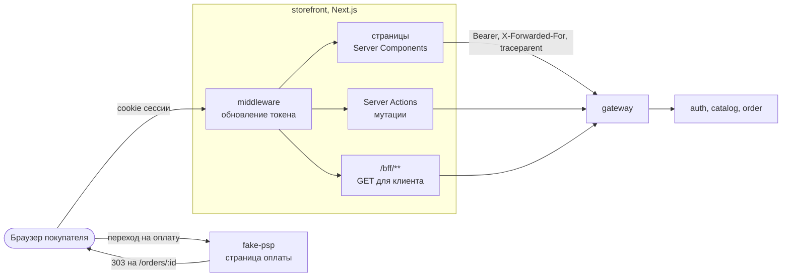
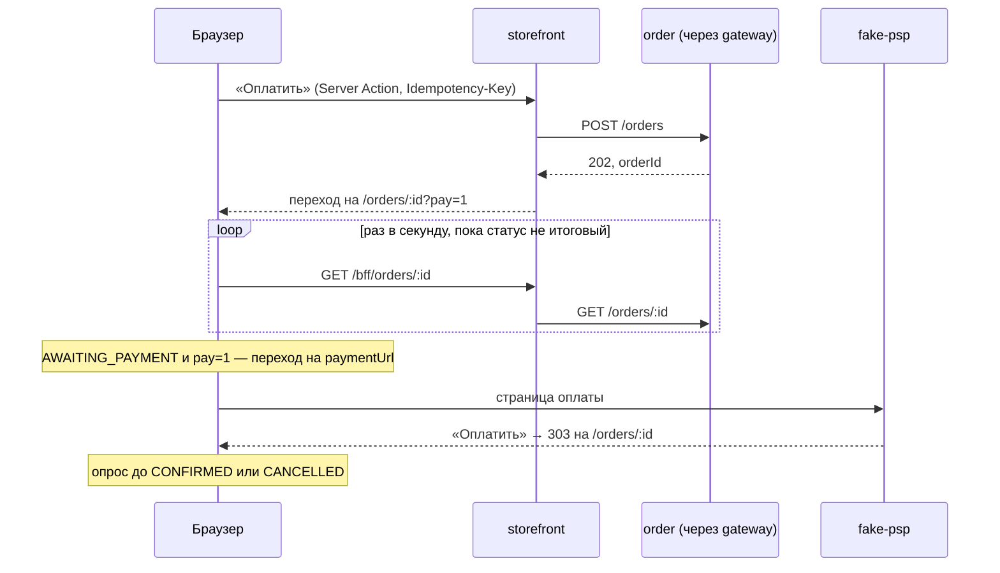

# System Design 07: Storefront (этап 7)

**Статус:** ✅ Утверждено · **Дата:** 2026-10-24 · **Ревизия:** 1

Этап 7 из ТЗ (раздел 8): витрина для покупателя. Покупатель впервые работает с системой через UI, а не HTTP-запросами. На этот этап перенесены корзина (SD-02, решение 1) и наличие на витрине (SD-05, п. 2). Правила заданы в ADR-0001 (наружу открыт только gateway, синхронно — только чтение), ADR-0003 (Next.js в монорепо, контракты, границы модулей), ADR-0005 (оформление, `Idempotency-Key`, опрос статуса), ADR-0006 (покупатель — только из проверенного токена) и ТЗ, 3.3 и 3.8.

## 1. Критерий готовности

ТЗ, раздел 8: «Покупка от каталога до „мои заказы“ через UI. Корзина (3.3) делается здесь».

| #   | Сценарий                                                 | Ожидаемый результат                                                                                                                                                                  |
| --- | -------------------------------------------------------- | ------------------------------------------------------------------------------------------------------------------------------------------------------------------------------------ |
| 1   | Гость смотрит каталог                                     | Дерево категорий; поиск по-русски и по-узбекски (латиница и кириллица); фильтры по категории, цене и наличию; «показать ещё». Только опубликованные товары активных магазинов, у товара — цена «от», магазин, наличие |
| 2   | Карточка товара                                          | Выбор SKU по атрибутам меняет цену и наличие; SKU нет в наличии — кнопка «В корзину» недоступна                                                                                       |
| 3   | Гость собрал корзину и вошёл                             | Гостевая корзина объединена с серверной (берётся большее количество) и удалена из браузера; повтор объединения ничего не меняет                                                         |
| 4   | Покупка у двух продавцов через UI                        | Корзина → адрес → страница fake-psp, «Оплатить» → возврат в витрину → «Заказ оформлен», два под-заказа с названиями магазинов; купленных позиций в корзине нет; заказ в «Моих заказах». Оформление — один трейс в Jaeger, начинается в storefront |
| 5   | Банк отклонил оплату                                     | «Отклонить» → возврат в витрину → «Ожидает оплаты» и кнопка «Перейти к оплате»; вторая попытка проходит                                                                               |
| 6   | Двойное нажатие «Оплатить», обрыв сети при оформлении    | Один заказ: один `Idempotency-Key` на попытку оформления                                                                                                                             |
| 7   | Товар закончился, пока покупатель оформлял заказ          | Заказ отменён с причиной «товара не хватило»; в корзине отмечены недостающие позиции, сама корзина не тронута                                                                         |
| 8   | Покупатель отменил под-заказ до отгрузки                 | Под-заказ «Отменён», затем «Деньги возвращены»; второй под-заказ не изменился                                                                                                         |
| 9   | Наличие на витрине                                       | Продавец обнулил остаток (API кабинета erp) → «Нет в наличии»; вернул остаток → «В наличии». Последний экземпляр в неоплаченном заказе — «Нет в наличии», пока резерв не снят         |
| 10  | Сессия                                                   | Истёкший access-токен обновляется незаметно; пять параллельных запросов с истёкшим токеном — одно обновление, семейство не отозвано; выход отзывает refresh; браузерный JS токенов не видит |
| 11  | Защита BFF и лимит запросов                              | Server Action с чужим `Origin` отклонён; лимит гостей считается по IP клиента, а не по адресу storefront; подделанный `X-Forwarded-For` мимо storefront не учитывается                  |
| 12  | Сценарии этапов 2–6                                      | Проходят                                                                                                                                                                             |

## 2. Что входит и что нет

**Входит:**

- `apps/storefront` — Next.js (App Router), TypeScript, Tailwind, shadcn/ui. Страницы из ТЗ, 3.8: каталог, поиск, карточка товара, корзина, оформление, мои заказы, отмена под-заказа; вход и регистрация.
- Корзина в order: серверная для вошедшего покупателя, гостевая — в браузере, объединяются при входе (ТЗ, 3.3).
- Наличие на витрине: событие `stock.level-changed` из erp, read-модель в catalog (SD-05, п. 2).
- Возврат покупателя со страницы оплаты fake-psp в витрину.
- Демо-витрина для ручного просмотра (решение 12).

**Не входит:**

- Кабинет продавца и админка — этап 8 (backoffice). В SD-03 и SD-04 сказано «UI кабинета — этап 7»; прав ТЗ, формулировки исправляются в конце этапа (п. 11).
- Узбекская локаль интерфейса — после MVP; ключи текстов закладываются сейчас.
- Загрузка изображений, рейтинг, отзывы, избранное, «снова в наличии», промокоды — после MVP (ТЗ, 3.2, 3.3, 3.6).
- Оформление без входа: покупатель берётся только из токена (ADR-0006). Гость собирает корзину, а оформляет её после входа.
- Восстановление пароля и подтверждение email — их нет в ТЗ.
- Push статуса заказа (SSE): витрина опрашивает статус, как сказано в ADR-0005, п. 9.

## 3. Архитектура витрины



### 3.1 BFF и сессия

Браузер говорит только со storefront, а storefront — только с gateway (решение 1). ADR-0001, п. 1 соблюдается: во внутренние сервисы фронт не ходит.

- **Cookie.** `sf_access` — access-токен, `sf_refresh` — refresh-токен; оба `HttpOnly`, `SameSite=Lax`, `Path=/`, срок — как у токенов (15 минут и 7 дней). `Secure` — когда `PUBLIC_URL` на https. Браузерный JS токенов не видит; в ответах `/bff/**` их нет.
- **Обновление.** Middleware (`proxy.ts`) на каждый запрос страницы, Server Action и `/bff/**`: access нет или он истекает меньше чем через 60 с, а refresh есть → `POST /api/auth/refresh`. Новые cookie уходят в ответ и в текущий запрос. `401` — cookie удаляются, пользователь становится гостем.
- **Одно обновление на refresh-токен** (решение 2). Пока обновление идёт, остальные запросы с тем же refresh ждут его результата; результат хранится 30 с по SHA-256 старого токена. Без этого две вкладки или параллельные запросы предъявят один refresh дважды, и auth отзовёт всё семейство (SD-05, п. 5.2).
- **Вход.** Server Action → `POST /api/auth/login` → cookie → объединение гостевой корзины (п. 5.3) → переход на `next`. Регистрация — `POST /api/auth/register`, затем тот же вход. Выход — `POST /api/auth/logout` (семейство refresh отзывается) и удаление cookie.
- **Кто вошёл.** Layout вызывает `GET /api/auth/me` и показывает email в шапке. Роли storefront не проверяет: доступ к данным покупателя проверяют gateway и сервисы (ADR-0006, п. 4).
- **Запросы в gateway.** `Authorization: Bearer`, новый `X-Request-Id` на каждый запрос страницы или действия, `X-Forwarded-For` с IP клиента (решение 9), `traceparent` из OpenTelemetry. Ответы разбираются схемами `libs/contracts` (п. 4): поломанный контракт виден сразу, а не в разметке.
- **CSRF.** Мутации — только Server Actions: Next.js сверяет `Origin` с хостом и отклоняет чужие. Route handlers `/bff/**` принимают только `GET` и ничего не меняют. Cookie с `SameSite=Lax` не уходят с кросс-сайтовыми `POST` (решение 3).

### 3.2 Страницы

| Путь              | Что на странице                                                                                                  | Данные                                                         |
| ----------------- | ---------------------------------------------------------------------------------------------------------------- | -------------------------------------------------------------- |
| `/`               | Каталог: дерево категорий, поиск, фильтры (категория, цена в сумах, «в наличии»), «показать ещё» по курсору      | `GET /catalog/search`, `GET /catalog/categories`               |
| `/products/[id]`  | Карточка: изображение или заглушка, описание, выбор SKU по атрибутам, цена, наличие, магазин, «В корзину»          | `GET /catalog/products/:id`                                    |
| `/cart`           | Позиции по магазинам, количество, удаление, итог; недоступные позиции отмечены и в оформление не идут             | гость — `localStorage` и `/bff/skus`; вошедший — `GET /cart` и `GET /catalog/skus` |
| `/checkout`       | Адрес доставки (схема `ShippingAddress`), состав заказа, итог, «Оплатить»                                         | `GET /cart`                                                    |
| `/orders`         | Мои заказы: дата, сумма, статус; курсор                                                                          | `GET /orders`                                                  |
| `/orders/[id]`    | Статус оформления с опросом, переход на оплату, под-заказы по магазинам, отмена под-заказа, статус возврата       | `/bff/orders/:id`, `GET /catalog/sellers`                      |
| `/login`, `/register` | Вход и регистрация с параметром `next`                                                                       | auth                                                           |

- Страницы рендерятся на сервере; клиентские компоненты — выбор SKU, корзина, форма оформления и опрос статуса.
- `/checkout` и `/orders/**` требуют входа: гость уходит на `/login?next=…`.
- Цена в URL фильтра — в сумах, в API — в тийинах. Суммы на экране — `formatSum` из `libs/contracts` (п. 4).
- Статусы — понятным текстом на каждое значение `CheckoutState`, `CancelReason` и `SubOrderStatus`; unit-тест не даст забыть новое значение перечисления.
- Страницы каталога без кеша: наличие должно быть свежим. Кеширование — вместе с целевыми показателями нагрузки (ТЗ, раздел 5).

### 3.3 Оформление и оплата



- **`Idempotency-Key`** (ADR-0005, п. 9) создаёт браузер, когда открывается форма оформления; он передаётся в Server Action скрытым полем. Пока ответа нет, кнопка заблокирована; повтор после обрыва сети идёт с тем же ключом. Если покупатель изменил адрес — это новая попытка и новый ключ: тот же ключ с другим телом order отклонил бы с `422`.
- **Позиции заказа** — доступные строки корзины: `POST /orders` по-прежнему принимает позиции, а не ссылку на корзину. Корзина очищается не при оформлении, а при подтверждении (п. 5.4).
- **Переход на оплату — один раз.** Со страницы оформления покупатель приходит с `?pay=1`, и при первом `AWAITING_PAYMENT` витрина сама открывает `paymentUrl`. Вернувшись после отказа банка (без `pay=1`), он видит «Ожидает оплаты» и кнопку «Перейти к оплате».
- **Возврат с оплаты.** payment передаёт провайдеру адрес возврата из своего конфига: `PAYMENT_RETURN_URL` с `{orderId}` (решение 7). fake-psp после «Оплатить» отвечает `303` на этот адрес, а после «Отклонить» остаётся на своей странице со ссылкой «Вернуться в магазин».
- **Опрос** — раз в секунду, пока вкладка видима и статус не итоговый (`CONFIRMED`, `CANCELLED`). Отменённый под-заказ опрашивается до `refundStatus = REFUNDED`.
- **Отмена.** `CANCELLED` с `out_of_stock` — «товара не хватило», недостающие SKU из `unavailableSkus` отмечаются в корзине. Остальные причины — своим текстом.

### 3.4 Структура приложения

```
apps/storefront/
  src/app/            # маршруты App Router: страницы, Server Actions, /bff/**, /health/*
  src/proxy.ts        # middleware: обновление токена (п. 3.1)
  src/server/         # только сервер (`server-only`): клиент gateway, сессия, cookie
  src/features/       # catalog, cart, checkout, orders: компоненты и их логика
  src/components/ui/  # компоненты shadcn/ui
  src/i18n/ru.json    # тексты интерфейса (решение 10)
  instrumentation.ts  # OpenTelemetry → Jaeger
```

- `server-only` в `src/server/**`: импорт оттуда в клиентский компонент — ошибка сборки, токены не попадут в бандл.
- Next.js: `output: 'standalone'`, корень трассировки файлов — корень монорепо (ADR-0003, п. 6); `transpilePackages: ['@repo/contracts']`.
- Теги Nx — `type:app`, `platform:web` (ADR-0003, п. 4). Поэтому `libs/observability` и `libs/auth` (`platform:node`) витрине недоступны: OpenTelemetry настраивается в `instrumentation.ts`, а JWT storefront не проверяет — это делают gateway и сервисы.
- Логи сервера storefront — JSON (pino) с `traceId` и `X-Request-Id`, как у сервисов (ADR-0001, п. 6). `/health/live` — процесс жив, `/health/ready` — gateway отвечает.
- Порт — 3001; `GATEWAY_URL` — адрес gateway для сервера storefront, `PUBLIC_URL` — адрес витрины для браузера.

## 4. Контракты

В `libs/contracts` (ADR-0003, п. 3) добавляются схемы, которые читает витрина. Сервисы отвечают по этим же схемам, поэтому расхождение ловят их собственные тесты.

| Файл                                   | Что                                                                                                                                         |
| -------------------------------------- | ------------------------------------------------------------------------------------------------------------------------------------------- |
| `api/catalog/storefront.ts`            | `SearchQuery`, `SearchResponse`, `ProductCard`, `CategoryTree`, `SkuLookupResponse`, `SellerNamesResponse`. Сейчас это интерфейсы в `apps/catalog/src/application/ports.ts` |
| `api/auth/session.ts`                  | `RegisterRequest`, `LoginRequest`, `TokenPair`, `MeResponse`                                                                                |
| `api/order/cart.ts`                    | `CartView`, `SetCartLineRequest`, `MergeCartRequest`, `MergeCartResponse`                                                                   |
| `api/order/orders.ts`                  | `OrderView`: + `unavailableSkus` (отмена из-за нехватки товара), + `refundStatus` под-заказа (`REQUESTED`, `REFUNDED` или `null`). Поля только добавляются |
| `events/erp/stock-level-changed.v1.ts` | `stock.level-changed`: `skuId`, `sellerId`, `inStock`; топик `erp.events`, ключ — SKU, агрегат `stock-level`. Фикстура контракт-теста     |
| `money.ts`                             | `formatSum`: «2 990 000 сум». Третье использование — fake-psp, notification, storefront, поэтому функция переезжает в контракты (ADR-0001, «libs по факту») |

Изменения в поиске и карточке: у результата поиска — `sellerName`, `image` (первое изображение или `null`), `inStock`; у карточки — `sellerName` и `inStock` у каждого SKU.

## 5. Корзина (order)

### 5.1 Данные

| Таблица      | Поля                                                                                         |
| ------------ | -------------------------------------------------------------------------------------------- |
| `cart_lines` | `buyer_id`, `sku_id`, `qty` (CHECK 1–99), `added_at`, `updated_at`; ключ — `(buyer_id, sku_id)` |

- Пределы — как у `POST /orders`: до 50 строк, количество — до 99.
- Строки покупателя меняются под `pg_advisory_xact_lock` по `buyer_id`: две вкладки не превысят 50 строк.
- Отдельной таблицы корзин нет: корзина — это строки покупателя.

### 5.2 API

Все маршруты — `@BuyerScope()`; в gateway — `/api/cart/**`.

| Метод и путь                | Что делает                                                                                                                         |
| --------------------------- | ---------------------------------------------------------------------------------------------------------------------------------- |
| `GET /cart`                 | Строки: `skuId`, `productId`, `sellerId`, `title`, `qty`, текущая цена из read-модели каталога, `available` (SKU опубликован и активен); итог по доступным строкам |
| `PUT /cart/lines/:skuId`    | `{ qty }` — задать количество; повтор даёт тот же результат. SKU нет в read-модели или он неактивен — `422`; 51-я строка — `422`   |
| `DELETE /cart/lines/:skuId` | Удалить строку; её уже нет — тоже `204`                                                                                            |
| `POST /cart/merge`          | `{ lines }` — объединить гостевую корзину (п. 5.3); ответ — корзина и `skipped`                                                    |

Цена в корзине справочная: заказ берёт цену в момент `POST /orders` (ADR-0005, п. 9). Изображения, атрибуты SKU и название магазина витрина берёт из catalog (решение 8).

### 5.3 Корзина гостя и объединение

- Гостевая корзина — `localStorage`, ключ `cart:v1`: `[{ skuId, productId, title, qty }]`. Название сохраняется на случай, если товар сняли с продажи и catalog его больше не отдаёт. Битые данные — пустая корзина, а не ошибка страницы.
- Данные строк гостевой корзины — `/bff/skus?ids=…` → `GET /catalog/skus`.
- При входе витрина вызывает `POST /cart/merge` и после ответа удаляет `cart:v1`.
- Правило: количество — **большее** из серверного и гостевого, но не больше 99 (решение 4). Неизвестные и неактивные SKU и строки сверх 50 попадают в `skipped`, витрина сообщает о них покупателю.

### 5.4 Очистка при подтверждении

- В транзакции перехода saga в `CONFIRMED` order вычитает купленное количество из корзины покупателя; строка с остатком 0 или меньше удаляется (решение 5).
- Отменённое оформление корзину не трогает: покупатель правит её и оформляет заново (ADR-0005, п. 8).
- Покупатель поменял корзину, пока платил, — вычитается только купленное, остальное остаётся.

## 6. Наличие на витрине (erp → catalog)

**erp:**

- Таблица `sku_levels`: `sku_id` (ключ), `seller_id`, `in_stock`, `version`.
- В транзакции, которая меняет доступный остаток, erp пересчитывает `available` SKU по всем складам продавца: резерв, повторный резерв при закреплении, снятие резерва (команда, TTL, отмена под-заказа), корректировка остатка, изменения склада. Это те же места, где проверяется `stock.low`, плюс снятие резерва.
- Событие `stock.level-changed` уходит в outbox, только когда «есть / нет» поменялось или строки `sku_levels` ещё не было (решение 6); `version` растёт на 1 — это `aggregateVersion`.
- Резерв занимает товар: последний экземпляр в неоплаченном заказе показывается «Нет в наличии» до оплаты или снятия резерва (до 30 минут). Это правда: заказать его сейчас нельзя.
- Остатки, созданные до этапа 7 (seed и работающий стенд): `erp-migrate` запускает `dist/sync-levels.js`. Он проходит все SKU с остатком и создаёт недостающие строки `sku_levels` с событием. Повторный запуск событий не повторяет.

**catalog:**

- Read-модель `sku_stock`: `sku_id`, `in_stock`, `version`. Она лежит отдельно от `skus`: SKU — часть агрегата товара catalog, и повторная модерация не должна стирать наличие.
- Событие с версией не больше сохранённой пропускается (ADR-0004, п. 3). Нет строки — «Нет в наличии».
- Группа `catalog-service` читает `erp.events` с начала (`fromBeginningTopics`, SD-05) и пропускает остальные события топика; DLQ — `catalog-service.dlq`.
- Поиск: товар `inStock`, если хотя бы один активный SKU в наличии; фильтр `inStock=true`; ранжирование не меняется.

order наличие не читает: корзина показывает его по данным catalog, а окончательная проверка — резерв в saga.

## 7. Изменения в существующих сервисах

| Где       | Что меняется                                                                                                                                                                     |
| --------- | -------------------------------------------------------------------------------------------------------------------------------------------------------------------------------- |
| order     | `cart_lines` и API корзины (п. 5); вычитание купленного при `CONFIRMED`; `checkout_sagas.unavailable_skus` из `stock.rejected` и `stock.commit-failed`; `unavailableSkus` и `refundStatus` в `OrderView` |
| catalog   | `sku_stock` по `stock.level-changed`; `sellerName`, `image`, `inStock` в поиске и карточке, фильтр `inStock`; публичные `GET /catalog/skus?ids=` (до 50 SKU опубликованных товаров активных магазинов) и `GET /catalog/sellers?ids=` (названия магазинов `active` и `blocked`: у них могли быть заказы) |
| erp       | `sku_levels`, `stock.level-changed`, `dist/sync-levels.js` в `erp-migrate`                                                                                                       |
| payment   | При создании платежа передаёт провайдеру `returnUrl` из `PAYMENT_RETURN_URL` (`{orderId}` заменяется)                                                                          |
| fake-psp  | Необязательный `returnUrl` у платежа: после «Оплатить» — `303` на него, после «Отклонить» — ссылка «Вернуться в магазин». Без `returnUrl` всё как раньше                           |
| gateway   | `/api/cart`, `/api/cart/*path` → order; `TRUST_PROXY` — адрес storefront, от которого принимается `X-Forwarded-For` (решение 9)                                                  |
| contracts | Схемы API, `stock.level-changed`, `formatSum` (п. 4)                                                                                                                            |

## 8. Стенд и CI

- **compose:** сервис `storefront` в профиле `full` (ADR-0001, п. 7), порт 3001, `GATEWAY_URL=http://gateway:3000`, `PUBLIC_URL=http://localhost:3001`, healthcheck `/health/ready`. У сети compose фиксированная подсеть, у storefront — фиксированный адрес: его доверяет gateway (решение 9). У payment — `PAYMENT_RETURN_URL=http://localhost:3001/orders/{orderId}`.
- **Просмотр:** `docker compose --profile full up -d --build` → http://localhost:3001, вход — `buyer-1@marketplace.test` с паролем `DEV_USER_PASSWORD` из `.env`.
- **Разработка:** `pnpm nx dev storefront` против стенда `core`, gateway — на `localhost:3000`.
- **CI:** job `check` проверяет storefront через `affected` (lint, typecheck, test, build). Job `e2e` собирает образ storefront, поднимает стенд с профилем `full` и после Jest-сценариев запускает Playwright в Chromium (решение 11). В `compose.e2e.yaml` — `SEED_SHOWCASE=false`.

## 9. Тестирование

| Уровень                         | Что                                                                                                                                                                                                                       |
| ------------------------------- | ------------------------------------------------------------------------------------------------------------------------------------------------------------------------------------------------------------------------- |
| Unit                            | storefront: разбор гостевой корзины (битые данные), объединение, тексты на каждое значение `CheckoutState`, `CancelReason`, `SubOrderStatus`, решение «пора обновить токен», одно обновление на refresh, `formatSum`. order: правило объединения, вычитание при подтверждении. erp: смена «есть / нет» |
| Интеграционные (Testcontainers) | order: покупатель видит и меняет только свою корзину (ADR-0006, п. 8), предел 50 строк при гонке двух запросов, повтор `merge`, очистка при `CONFIRMED` и нетронутая корзина при `CANCELLED`, `unavailableSkus`. erp: событие только при смене, версии, повтор `sync-levels`. catalog: `stock.level-changed` через Kafka, опоздавшее событие, наличие переживает повторную публикацию товара, фильтр `inStock`. gateway: `X-Forwarded-For` учитывается только от доверенного адреса (сценарий 11) |
| Контрактные                     | Фикстура `stock.level-changed.v1`                                                                                                                                                                                         |
| E2E API (Jest)                  | Наличие после корректировки остатка; корзина и объединение; `returnUrl` у fake-psp                                                                                                                                       |
| E2E UI (Playwright)             | Сценарии 1–10 и проверка `Origin` из сценария 11 — в браузере, оплата — кнопками страницы fake-psp                                                                                                                        |

## 10. Решения (согласовано)

1. **Storefront — BFF.** Браузер ходит только в storefront, токены лежат в `HttpOnly` cookie, сервер storefront ходит в gateway. Страницы с данными покупателя рендерятся на сервере. _Альтернатива:_ браузер ходит в gateway напрямую с CORS, а токены хранит JS — проще, но токены доступны любому XSS, и серверный рендер персональных страниц невозможен.
2. **Одно обновление токена на refresh** в middleware storefront: ожидающие запросы получают тот же результат, он хранится 30 с. Ограничение — один экземпляр storefront; для нескольких экземпляров нужен общий кеш (этап hardening).
3. **Мутации — Server Actions, чтение для клиентских компонентов — `GET /bff/**`.** Общего прокси `/api/**` в storefront нет: наружу торчит только то, что нужно UI, а защита от CSRF — встроенная проверка `Origin`. _Альтернатива:_ общий прокси на gateway — меньше кода, но CSRF-защиту и белый список путей пришлось бы писать самим.
4. **Гостевая корзина — `localStorage`; при объединении берётся большее количество.** Повтор объединения после обрыва сети ничего не удваивает. _Альтернатива:_ сумма количеств — привычнее в некоторых магазинах, но повтор запроса удвоил бы корзину.
5. **Корзина очищается при подтверждении заказа**, а не при оформлении: отказ банка, истёкшая оплата или нехватка товара не теряют корзину. `POST /orders` не меняется.
6. **`stock.level-changed` — только при смене «есть / нет».** Событие на каждый резерв нагружало бы `erp.events` без пользы для витрины. Число «осталось 3 шт.» — после MVP, с отдельным полем.
7. **Адрес возврата с оплаты — из конфига payment**, а не из запроса витрины: открытого редиректа нет, контракты `POST /orders` и `CreatePayment` не меняются.
8. **Данные для показа — синхронным чтением из catalog** (`/catalog/skus`, `/catalog/sellers`, ADR-0001, п. 3), а не новыми read-моделями в order. Цена в корзине — из read-модели order, потому что по ней order оформит заказ. Таймаут — 2 с; если catalog недоступен, корзина и заказы показываются без изображений и названий магазинов (название позиции — из order или гостевой корзины), а не падают.
9. **Лимит гостей — по IP клиента.** gateway принимает `X-Forwarded-For` только от фиксированного адреса storefront в сети compose. Иначе все гости делили бы один лимит на адрес storefront, а любой мог бы подделать заголовок, обратившись к gateway напрямую.
10. **Тексты — next-intl**, словарь `ru`, локаль без префикса в URL. _Альтернатива:_ свой словарь — меньше зависимостей, но форматирование чисел, дат и множественного числа пришлось бы писать самим, а к узбекской локали — переделывать.
11. **UI-тесты — Playwright в `apps/e2e`**, в job `e2e` на том же стенде после Jest-сценариев, только Chromium. _Альтернатива:_ отдельный job со своим стендом — независимее, но добавляет к CI ещё 20+ минут.
12. **Демо-витрина** — отдельный набор `DEV_SHOWCASE` в `libs/contracts/src/dev`: около 20 товаров двух демо-магазинов в четырёх категориях с остатками на складах. Seed — при `SEED_SHOWCASE=true` (по умолчанию в профиле `full`). E2E работает с прежними пятью SKU, ожидания `run.sh` не меняются. Изображений нет, витрина рисует заглушку по категории.

## 11. Порядок работ

1. Контракты: схемы API catalog, auth и корзины, `OrderView`, `stock.level-changed`, `formatSum`; DLQ `catalog-service.dlq`.
2. erp: `sku_levels`, событие, `sync-levels`; catalog: read-модель наличия, поля поиска и карточки, `/catalog/skus`, `/catalog/sellers`; тесты.
3. order: корзина, вычитание при подтверждении, `unavailableSkus`, `refundStatus`; payment и fake-psp: адрес возврата; gateway: `/api/cart/**`, `TRUST_PROXY`; тесты.
4. `apps/storefront`: Nx и Next.js, Tailwind, shadcn/ui, next-intl, OpenTelemetry; BFF и сессия; страницы; unit-тесты.
5. Стенд: Dockerfile, compose `full`, демо-витрина; e2e API.
6. Playwright-сценарии п. 1 и CI.
7. CHANGELOG, SD-07 → «Реализовано», ТЗ: этап 7 ✅, SD-00 (storefront, `stock.level-changed` у catalog, маршрут корзины), README; в SD-03 и SD-04 «UI кабинета — этап 7» → «этап 8».

## Открытые вопросы

- Push статуса заказа (SSE) вместо опроса (ADR-0005).
- Несколько экземпляров storefront: общий кеш обновления токена (решение 2).
- Кеширование страниц каталога — вместе с целевыми показателями нагрузки (ТЗ, раздел 5).
- Адресная книга покупателя; предупреждение «цена изменилась» в корзине.
