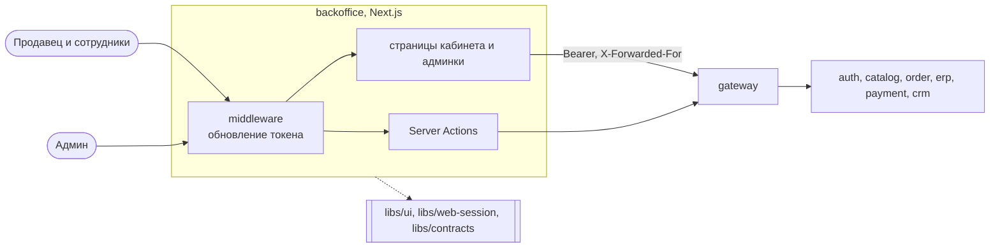

# System Design 08: Backoffice (этап 8)

**Статус:** ✅ Реализовано · **Дата:** 2026-10-25 · **Ревизия:** 2

Этап 8 из ТЗ (раздел 8): кабинет продавца и админка платформы в одном приложении `apps/backoffice`. Почти всё API уже есть: кабинет — с этапов 3–6 (`/api/seller/**`), админка — с этапов 4–6 (`/api/admin/**`). Этап — про UI, общий код двух фронтов и сценарии в браузере. Правила заданы в ADR-0001 (два фронта, наружу открыт только gateway), ADR-0003 (`libs/ui` и другие libs — когда появился второй потребитель), ADR-0006 (роли, права сотрудников, `404` на чужое, `403` без права), ADR-0007 (деньги продавца) и ТЗ, 3.2–3.8.

## 1. Критерий готовности

ТЗ, раздел 8: «Кабинет продавца и админка: все действия MVP доступны через UI».

| #   | Сценарий                                              | Ожидаемый результат                                                                                                                                                     |
| --- | ----------------------------------------------------- | ----------------------------------------------------------------------------------------------------------------------------------------------------------------------- |
| 1   | Пользователь регистрирует магазин                     | Магазин «на модерации», кабинет открыт сразу (токен обновлён), товар не опубликовать, пока магазин не одобрен; админ одобряет — магазин активен                        |
| 2   | Продавец заводит товар                                | Черновик → SKU с ценой и атрибутами, ссылки на изображения → «на модерацию»; админ одобряет — товар на витрине; отклоняет — продавец видит причину                       |
| 3   | Правка опубликованного товара                         | Цена и активность SKU — сразу; текст, категория, состав SKU — товар снова на модерации                                                                                  |
| 4   | Склады и остатки                                      | Склад создан, приоритет и включение меняются; приход и списание; ниже резерва — понятная ошибка; порог низкого остатка; остатки показаны с названиями товаров и SKU      |
| 5   | Заказы                                                | Под-заказы магазина с фильтром по статусу; адрес доставки без email покупателя; «Отгрузить», «Доставлен», «Отменить» по правилам ADR-0005, п. 5                         |
| 6   | Финансы и выплаты                                     | Баланс «в ожидании» и «доступно», история операций, сводка; после доставки и удержания деньги доступны; выплата не больше доступного и не меньше минимальной; статус выплаты |
| 7   | Покупатели магазина                                   | Список с метриками и сегментами, фильтр по сегменту; профиль — заказы только этого магазина, без контактов (ADR-0006, п. 6)                                               |
| 8   | Сотрудники                                            | Владелец добавляет пользователя по email и выдаёт права; сотрудник видит только разделы своих прав; убрать право — раздел сразу пропадает из меню, API отказывает после обновления токена (до 15 минут) |
| 9   | Админка: магазины и товары                            | Очереди модерации магазинов и товаров, одобрение, отклонение с причиной, блокировка магазина                                                                            |
| 10  | Админка: категории, комиссия, отчёты, покупатели      | Дерево категорий, создание и переименование; ставки комиссии по категориям и по умолчанию; отчёт по комиссии; сверка журнала; покупатели 360° и отчёт по сегментам      |
| 11  | Изоляция и права                                      | Чужой товар, склад, под-заказ по прямой ссылке — «не найдено»; без права — раздела нет в меню, прямая ссылка — «нет доступа»; покупатель без магазина — только регистрация магазина |
| 12  | Сценарии этапов 2–7                                   | Проходят                                                                                                                                                                |

## 2. Что входит и что нет

**Входит:**

- `apps/backoffice` — Next.js (App Router), как storefront: BFF, сессия в `HttpOnly` cookie, Server Actions, next-intl.
- Общий код двух фронтов — в libs (решение 2): `libs/ui` (компоненты), `libs/web-session` (сессия, обновление токена, клиент gateway, middleware).
- Схемы API кабинета и админки — в `libs/contracts` (решение 6).
- Немедленное обновление токена после регистрации магазина и изменения своих прав (решение 4).
- gateway: `TRUST_PROXY` — адреса storefront и backoffice.

**Не входит:**

- Загрузка изображений — после MVP (ТЗ, 3.2); товар хранит ссылки.
- Графики и аналитика: сводки — числами, графики — после MVP.
- Споры и возвраты после доставки, автоматические выплаты, закрывающие документы — после MVP (ТЗ, 3.3, 3.5).
- Тикеты поддержки, NPS — после MVP (ТЗ, 3.6).
- Узбекская локаль — после MVP; ключи текстов есть.
- Журнал действий админа — после MVP (ADR-0006, п. 7); действия пишутся в структурный лог сервисов, как сейчас.

## 3. Архитектура

### 3.1 Сессия и роли

- Сессия — как у витрины (SD-07, п. 3.1), но свои cookie: `bo_access`, `bo_refresh`. Cookie не различают порты: на `localhost` у витрины и кабинета общий набор cookie, и с одними именами вход в один фронт подменял бы сессию другого.
- Кто вошёл и что ему можно — `GET /api/auth/me`: роли и права по базе, а не по токену, который отстаёт до 15 минут (SD-05, п. 5.3). Меню строится по ним; доступ всё равно проверяют сервисы (ADR-0006, п. 4).
- Разделы: продавец-владелец — все; сотрудник — по правам `catalog`, `warehouse`, `orders`, `support`, `finance`; «Сотрудники» — только владельцу (`staff`); админ — «Админка». У пользователя может быть и магазин, и роль админа — видны оба раздела.
- Пользователь без магазина видит одну страницу — «Открыть магазин».
- Обновление токена сразу (решение 4) — после `POST /api/sellers`: только что открытый магазин иначе ждал бы роль владельца до 15 минут. Права сотрудника, которые поменял владелец, вступают в силу в API при следующем обновлении токена сотрудника — до 15 минут (ТЗ, 3.1); меню у него меняется сразу, потому что строится по `GET /auth/me`.

### 3.2 Страницы кабинета продавца

| Путь                         | Право       | Что на странице                                                                                     | API                                                                       |
| ---------------------------- | ----------- | --------------------------------------------------------------------------------------------------- | ------------------------------------------------------------------------- |
| `/`                          | любое       | Сводка: статус магазина, под-заказы к отгрузке, баланс, низкие остатки — по правам                 | `GET /seller/shop`, `/seller/sub-orders`, `/seller/finance/balance`, `/seller/stock` |
| `/open-shop`                 | без магазина | Регистрация магазина                                                                               | `POST /sellers`                                                           |
| `/products`, `/products/new`, `/products/[id]` | `catalog` | Товары со статусом модерации; редактор: текст, категория, ссылки на изображения, SKU (код, атрибуты, цена, активность), отправка на модерацию, архив; причина отклонения | `/seller/products/**`, `GET /catalog/categories`                          |
| `/stock`                     | `warehouse` | Склады (создать, приоритет, включить, выключить); остатки по SKU и складам с названиями товаров; приход и списание; порог | `/seller/warehouses/**`, `/seller/stock/**`, `GET /seller/products`        |
| `/orders`, `/orders/[id]`    | `orders`    | Под-заказы с фильтром по статусу и курсором; адрес доставки; «Отгрузить», «Доставлен», «Отменить»   | `/seller/sub-orders/**`                                                   |
| `/finance`                   | `finance`   | Баланс, операции с курсором, сводка по продажам; выплаты: запрос и история                          | `/seller/finance/**`, `/seller/payouts`, `/seller/sales/summary`          |
| `/customers`, `/customers/[buyerId]` | `support` | Покупатели магазина, метрики, сегменты; профиль без контактов                                   | `/seller/customers/**`                                                    |
| `/staff`                     | `staff`     | Сотрудники: добавить по email, права, убрать                                                       | `/seller/staff/**`                                                        |

### 3.3 Страницы админки

| Путь                    | Что на странице                                                                         | API                                                     |
| ----------------------- | --------------------------------------------------------------------------------------- | ------------------------------------------------------- |
| `/admin/sellers`        | Магазины по статусу; одобрить, отклонить с причиной, заблокировать                      | `/admin/sellers/**`                                     |
| `/admin/products`       | Товары на модерации: текст, SKU, цены; одобрить или отклонить с причиной                | `/admin/products/**`                                    |
| `/admin/categories`     | Дерево; создать в корне или в выбранной; переименовать                                  | `GET /catalog/categories`, `/admin/categories/**`       |
| `/admin/commission`     | Ставки по категориям и по умолчанию; отчёт по комиссии за период; сверка журнала        | `/admin/commission-rates/**`, `/admin/reports/commission`, `/admin/ledger/check` |
| `/admin/customers`      | Покупатели с email и сегментами; профиль 360°; отчёт по сегментам                        | `/admin/customers/**`, `/admin/reports/segments`        |

### 3.4 Общее

- Названия товаров на странице остатков — синхронное чтение `GET /seller/products` (catalog) рядом с `GET /seller/stock` (erp), без новой read-модели (решение 5). catalog недоступен — остатки показаны по SKU-кодам из erp.
- Суммы вводятся в сумах, в API — тийины; показываются `formatSum` (SD-07, п. 4). Ставка комиссии вводится в процентах, в API — базисные пункты.
- Ошибки API — понятным текстом: `409` (остаток ниже резерва, недопустимый переход под-заказа, занятый сотрудник), `422` (выплата больше доступного или меньше минимальной), `403` — «нет доступа», `404` — «не найдено».
- Порт — 3002; в compose — профиль `full`, фиксированный адрес `172.30.240.201`.

## 4. Общий код фронтов (libs)

Второй фронт — второй потребитель кода storefront, и по ADR-0003 он выносится в libs (решение 2).

| Lib                | Теги                         | Что                                                                                                         |
| ------------------ | ---------------------------- | ----------------------------------------------------------------------------------------------------------- |
| `libs/ui`          | `type:ui`, `platform:web`    | `Button`, `Input`, `Card`, `Badge`, `ProductImage`, `cn`; стили — Tailwind из приложения                    |
| `libs/web-session` | `type:infra`, `platform:web` | Срок токена, одно обновление на refresh, cookie сессии с именами приложения, клиент gateway, фабрика middleware, `safeNext` |

- storefront переходит на эти libs без изменения поведения: его unit- и Playwright-сценарии — страховка.
- `libs/web-session` зависит от `next` как peer-зависимость: версия одна на монорепо.

## 5. Контракты

В `libs/contracts` — схемы ответов, которые читает backoffice (решение 6): `api/catalog/cabinet.ts` (магазин, товар продавца, модерация), `api/erp/cabinet.ts` (склады, остатки, пороги, сводка продаж), `api/order/seller.ts` (под-заказы продавца), `api/payment/finance.ts` (баланс, операции, сводка, выплаты, ставки, отчёт по комиссии, сверка), `api/crm/customers.ts` (покупатели магазина и админки, отчёт по сегментам), `api/auth/staff.ts` (сотрудники). Сейчас это интерфейсы и zod-схемы внутри сервисов; сервисы начинают отвечать по схемам из контрактов, тела запросов разбирают ими же.

## 6. Изменения в существующих сервисах

| Где       | Что меняется                                                                                                   |
| --------- | -------------------------------------------------------------------------------------------------------------- |
| contracts | Схемы API кабинета и админки (п. 5)                                                                            |
| catalog, erp, order, payment, crm, auth | Ответы и тела запросов — по схемам контрактов; поведение не меняется                 |
| gateway   | `TRUST_PROXY` — адреса storefront и backoffice                                                                 |
| storefront | Компоненты и сессия — из `libs/ui` и `libs/web-session`                                                       |
| compose   | `backoffice` в профиле `full`, порт 3002, адрес `172.30.240.201`                                               |
| e2e       | Playwright-сценарии кабинета и админки на том же стенде                                                        |

## 7. Тестирование

| Уровень             | Что                                                                                                                                                       |
| ------------------- | --------------------------------------------------------------------------------------------------------------------------------------------------------- |
| Unit                | `libs/web-session` (перенесённые тесты storefront); меню по ролям и правам; суммы и проценты в форме → тийины и базисные пункты; тексты на каждое значение статусов магазина, товара, под-заказа, выплаты, сегмента |
| Контрактные         | Сервисы отвечают по схемам контрактов — их интеграционные тесты разбирают ответы схемами                                                                  |
| E2E UI (Playwright) | Сценарии 1–11 п. 1: новый магазин от регистрации до выплаты, сотрудник с частью прав, админка; изоляция — магазин B открывает ссылку на товар магазина A |

## 8. Решения (согласовано)

1. **Кабинет продавца и админка — одно приложение `apps/backoffice`** с разделами по ролям, как в ADR-0001 и ТЗ. _Альтернатива:_ два приложения — у админа и продавца разные пользователи, но код, сессия и стенд удвоились бы.
2. **Общий код — в `libs/ui` и `libs/web-session`** (ADR-0003: lib — когда понадобилась во втором проекте). _Альтернатива:_ копия в backoffice — быстрее сейчас, но два места для исправления ошибок сессии.
3. **Свои имена cookie у каждого фронта** (`sf_*`, `bo_*`): на одном хосте cookie не различают порты. Покупатель может войти в витрину и в кабинет разными учётными записями.
4. **Токен обновляется сразу после регистрации магазина** — у того, кто его открыл: иначе роль владельца появилась бы только через 15 минут. Изменения прав сотрудников, как и сейчас, — при следующем обновлении их токена; мгновенный отзыв — после MVP (ТЗ, 3.1).
5. **Названия товаров на странице остатков — синхронным чтением из catalog**, а не read-моделью в erp: страница одна, данные для показа (ADR-0001, п. 3).
6. **Схемы API кабинета и админки — в `libs/contracts`**, как схемы витрины (ADR-0003, п. 3). _Альтернатива:_ типы только во фронте — проще, но расхождение с сервисом увидит только пользователь.
7. **Сводка на главной — числами**, без графиков; графики — после MVP вместе с Grafana (этап 9) и аналитикой.
8. **Минимальная выплата — 100 000 сум, удержание после доставки — 7 дней**: это текущие значения конфига payment (`MIN_PAYOUT_MINOR`, `SELLER_HOLD_MS`). Закрывают открытые вопросы ТЗ, раздел 10; кабинет показывает оба значения продавцу.
9. **UI-тесты — в том же job `e2e`** после сценариев витрины, на одном стенде.

## 9. Порядок работ

1. `libs/ui`, `libs/web-session`; storefront на них; тесты.
2. Контракты API кабинета и админки; сервисы отвечают по ним; тесты.
3. `apps/backoffice`: каркас, сессия, меню по ролям, регистрация магазина.
4. Кабинет: товары, склады и остатки, заказы.
5. Кабинет: финансы и выплаты, покупатели, сотрудники.
6. Админка: магазины, товары, категории, комиссия, отчёты, покупатели.
7. Стенд: Dockerfile, compose, `TRUST_PROXY`; Playwright-сценарии; CI.
8. CHANGELOG, SD-08 → «Реализовано», ТЗ: этап 8 ✅, раздел 10 — решение 8, SD-00, README.

## 10. Итог

Сценарии п. 1 проходят в CI job `e2e`: 1–11 — Playwright (`apps/e2e/src/ui/backoffice.ui-spec.ts`), 12 — Jest-сценарии этапов 2–7 и Playwright-сценарии витрины на том же стенде. Unit-тесты кабинета — в `check`. Уточнения по ходу реализации:

- **Новый токен после открытия магазина — прямо в Server Action** (`refreshNow` в `libs/web-session`), а не удалением access-cookie до следующего запроса: после действия с изменёнными cookie Next перерисовывает страницу в том же ответе, мимо middleware, и без access-токена страница сочла бы пользователя вышедшим. Членство владельца auth заводит по событию — действие ждёт его по `GET /auth/me` до 10 с.
- **Товар магазина на модерации отправить на модерацию можно, опубликовать — нет:** одобрение требует активного магазина (SD-05). Сценарий 1 уточнён.
- **В `PATCH` текста товара — только изменённые поля:** catalog отправляет опубликованный товар на модерацию при любом `PATCH`, даже без изменений. Код и атрибуты SKU catalog сравнивает сам.
- **Формы** отправляются через `onSubmit` и `useActionState`, а не `<form action>`: React сбрасывает поля после любого действия, и введённое пропадало бы при ошибке. Кнопки ждут гидратации (`useHydrated` в `libs/ui`) — до неё браузер отправил бы форму сам, GET-запросом с паролем в адресе; это касается и витрины.
- **Ошибки API** — текстом по статусу; объяснение сервиса показывается у `400`, `409` и `422`, разбор zod — нет: форма проверяет поля до отправки.
- **Ссылки на изображения** в очереди модерации кликабельны только с `http(s)`: их задаёт продавец.
- **Ставка комиссии** вводится в процентах до сотых, в API — базисные пункты; отчёт по комиссии считается по дням Ташкента (UTC+5). Срок удержания показывается в крупнейших целых единицах: 7 дней в обычной конфигурации, секунды на стенде e2e.
- **Права сотрудника** — чекбоксами; `staff` выдать нельзя, хотя бы одно право обязательно (`StaffScopes`).
- **`libs/ui` и `libs/web-session` — ESM и отдают бандлеру исходники TypeScript:** Next транспилирует их сам, `dist` — только типы. CommonJS-сборка tsc в бандле middleware теряла `require("next/server")`, и оба фронта отвечали `500` на каждый запрос; `next build` этого не видит — только запуск.

## Открытые вопросы

- Пагинация списка товаров продавца: catalog отдаёт до 200 товаров — хватит для MVP, курсор — когда понадобится.
- Мгновенный отзыв прав сотрудника (ТЗ, 3.1).
- Журнал действий админа (ADR-0006, п. 7).
